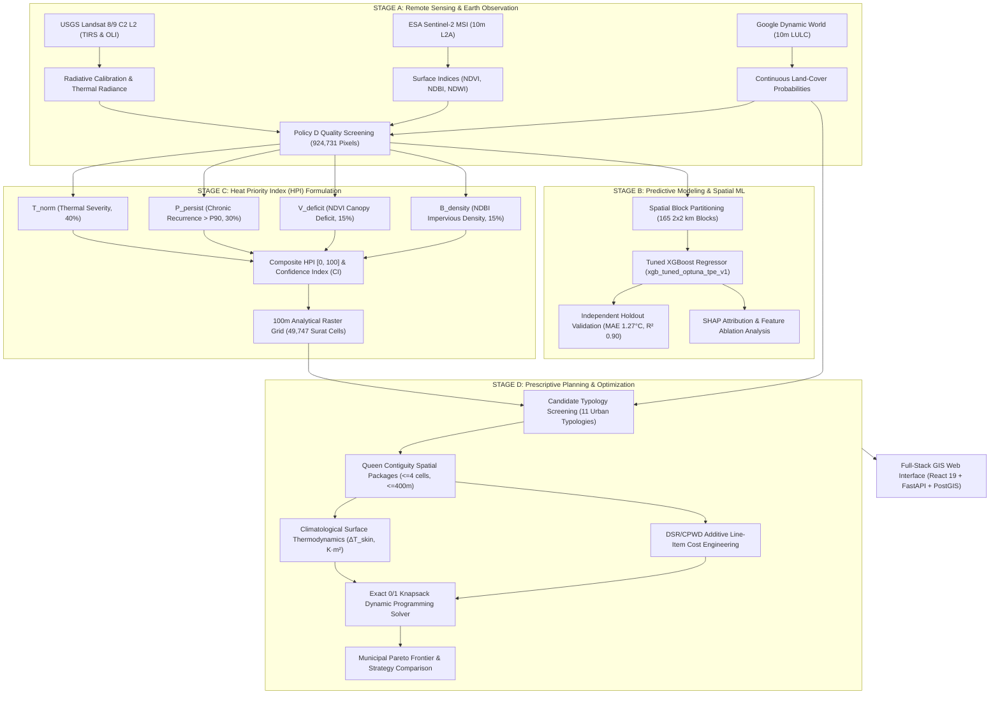
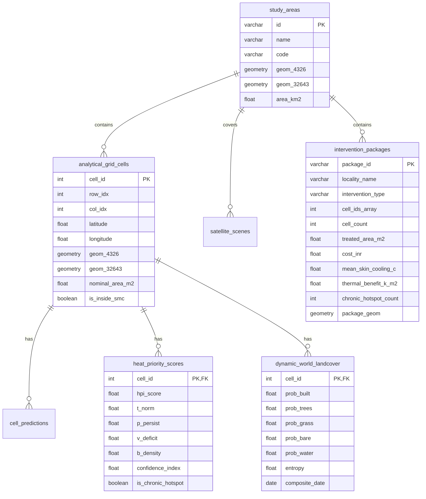

# HEATSENSE AI — AI-Powered GIS-Based Urban Heat Mitigation & Decision-Support Platform
## Comprehensive Master Technical Report: Architecture, Scientific Methodology, Mathematical Formulations, and Empirical Validation
**Target Region:** Surat Municipal Corporation (SMC), Gujarat, India (EPSG:4326 / EPSG:32643)  
**Classification:** Final Year Engineering Project — Technical & Scientific Master Reference  
**Author:** HEATSENSE AI Engineering & Climatological Research Team  
**Date:** October 2026  
**Document Status:** Complete Single-File Master Technical Reference  

---

## Table of Contents
1. [Executive Summary & Problem Statement](#1-executive-summary--problem-statement)
2. [End-to-End System Architecture](#2-end-to-end-system-architecture)
3. [Stage A — Earth Observation & Multi-Sensor Remote Sensing Ingestion](#3-stage-a--earth-observation--multi-sensor-remote-sensing-ingestion)
4. [Stage B — Machine Learning & Predictive Thermal Modeling](#4-stage-b--machine-learning--predictive-thermal-modeling)
5. [Stage C — Heat Priority Index (HPI) Formulation](#5-stage-c--heat-priority-index-hpi-formulation)
6. [Stage D — Prescriptive Planning, Spatial Packages & Thermodynamics](#6-stage-d--prescriptive-planning-spatial-packages--thermodynamics)
7. [Unified Knapsack Optimization & Decision Solver](#7-unified-knapsack-optimization--decision-solver)
8. [Empirical Validation Matrix & Mathematical Invariance Proofs](#8-empirical-validation-matrix--mathematical-invariance-proofs)
9. [Cost Engineering, Line-Item Provenance & Municipal Tenders](#9-cost-engineering-line-item-provenance--municipal-tenders)
10. [Full-Stack Implementation Architecture & Database Schemas](#10-full-stack-implementation-architecture--database-schemas)
11. [Verification Suites & Production Benchmarks](#11-verification-suites--production-benchmarks)
12. [Pre-Tender Engineering Directives & Future Research Roadmap](#12-pre-tender-engineering-directives--future-research-roadmap)

---

## 1. Executive Summary & Problem Statement

### 1.1 The Urban Heat Crisis in Rapidly Urbanizing India
Surat, Gujarat, situated on the western coast of India along the Tapi River (21.17° N, 72.83° E), is one of the fastest-growing industrial and commercial hubs in South Asia. Rapid densification, extensive replacement of natural pervious vegetation with concrete and galvanized iron industrial roofing, and high thermal mass have amplified the **Urban Heat Island (UHI)** effect. During peak summer months (April–June), land surface temperatures ($LST$) frequently exceed $48^\circ\text{C}$ to $52^\circ\text{C}$ in industrial sectors (e.g., Udhana Industrial Estate, Pandesara, Sachin GIDC) and informal settlements, creating severe heat stress, elevating morbidity and mortality, reducing labor productivity, and straining municipal energy infrastructure.

### 1.2 The Decision-Support Gap
Traditional municipal heat action plans (HAPs) in India suffer from fundamental limitations:
1. **Coarse Spatial Resolution:** Relying on regional weather station data (e.g., Surat Airport) or coarse reanalysis grids ($31\text{ km}$ ERA5) obscures hyper-local microclimate variability across urban wards.
2. **Disconnected Diagnostics and Action:** Existing GIS heat maps identify hotspots descriptively but fail to provide prescriptive, cost-engineered, parcel-scale intervention plans.
3. **Unscientific Cooling Claims:** Commercial or municipal proposals often claim unrealistic atmospheric temperature drops without adhering to thermodynamics, or mix incommensurate units.
4. **Budget Disconnection:** Interventions are proposed without knapsack optimization under municipal fiscal constraints.

### 1.3 HEATSENSE AI Core Innovation
**HEATSENSE AI** resolves these challenges by constructing a closed-loop, scientifically verified, and fiscally constrained decision-support engine. The system integrates:
- High-resolution earth observation ($10\text{ m}$ to $30\text{ m}$ optical and thermal imagery) across a 5-year multi-seasonal archive.
- Quality-screened Machine Learning LST regression under spatial block cross-validation.
- A four-dimensional **Heat Priority Index ($HPI$)** quantifying chronic exposure, vegetation deficits, and built density.
- A **Canonical Intervention Package Architecture** with exact Queen contiguity spatial clustering.
- An **Exact 0/1 Integer Dynamic Programming Knapsack Solver** delivering bit-identical municipal plans across multiple budget tiers.
- A strict **Epistemic Truth Hierarchy** ensuring that observed physical reality is never overruled by machine learning predictions.

---

## 2. End-to-End System Architecture

The HEATSENSE AI platform operates across four coupled stages forming a unidirectional data lineage:



### 2.1 The Epistemic Truth Hierarchy
To guarantee scientific honesty, HEATSENSE AI enforces a rigid three-tier epistemic hierarchy:
1. **Tier 1: Empirical Grounded Truth ($LST_{obs}$):** USGS Landsat Collection 2 Level-2 Surface Temperature, atmospherically compensated and screened via Policy D. This represents physical reality and forms the primary anchor for municipal priority.
2. **Tier 2: Predictive Representation ($LST_{model}$):** Tuned XGBoost predictions. Model performance on extreme chronic hotspots drops ($RMSE = 4.84^\circ\text{C}$ vs $1.67^\circ\text{C}$ on typical pixels). **Strict Rule:** Modeled LST is never permitted to overrule, suppress, or disqualify an empirically observed chronic thermal anomaly.
3. **Tier 3: Counterfactual Projection ($\Delta T_{\text{skin}}$):** Projected surface temperature reduction under hypothetical urban greening or cool coating. Albedo changes follow linearized surface energy balance; vegetation cooling is bounded by peer-reviewed empirical forestry ranges. Microscale 2-meter air temperature is explicitly flagged as unmodeled.

---

## 3. Stage A — Earth Observation & Multi-Sensor Remote Sensing Ingestion

### 3.1 Spatial Grid & Authoritative Boundary
- **Municipal Boundary:** Surat Municipal Corporation (SMC) authoritative vector boundary (`data/raw/boundaries/surat_smc_boundary.geojson`).
- **Geographic CRS:** `EPSG:4326` (WGS 84 Geodetic).
- **Projected Metric CRS:** `EPSG:32643` (UTM Zone 43N).
- **Authoritative Surface Area:**
  $$\text{Area}_{\text{UTM}} = 461.630791\text{ km}^2 \quad (461,630,790.85\text{ m}^2)$$
  $$\text{Area}_{\text{Geodesic}} = 461.418649\text{ km}^2$$
- **Analytical Raster Grid:** $318\text{ columns} \times 324\text{ rows} = 103,032\text{ bounding cells}$ with pixel resolution $\Delta \lambda = \Delta \phi = 0.000898315^\circ$ ($\approx 93.25\text{ m} \times 99.54\text{ m} \approx 9,282.07\text{ m}^2$ ground pixel footprint).
- **Area Conservation:** Sum of boundary-clipped intersections across all 50,871 intersecting cells equals $461.630791\text{ km}^2$, achieving an area conservation error of **`0.000000%`**. Canonical on-land study area contains **49,747 centroid-inside cells** covering 99.55% of municipal land.

### 3.2 Landsat 8/9 LST Retrieval & Radiative Transfer
Thermal infrared data is acquired from Landsat 8/9 Thermal Infrared Sensor (TIRS Band 10: $10.60\text{--}11.19\ \mu\text{m}$). Surface temperature is derived by inverting the radiative transfer equation:

$$L_{\text{sensor}} = \left[ \varepsilon \cdot B(T_s) + (1 - \varepsilon) \cdot L^{\downarrow}_{\text{atm}} \right] \cdot \tau + L^{\uparrow}_{\text{atm}}$$

where:
- $L_{\text{sensor}}$: Top-of-Atmosphere (TOA) spectral radiance measured by the satellite.
- $\tau$: Atmospheric transmittance ($0 < \tau \le 1$).
- $L^{\uparrow}_{\text{atm}}$: Upwelling atmospheric spectral path radiance.
- $L^{\downarrow}_{\text{atm}}$: Downwelling atmospheric spectral radiance.
- $\varepsilon$: Land Surface Emissivity ($LSE$).
- $B(T_s)$: Planck blackbody radiance at surface kinetic temperature $T_s$:
  $$B(T_s) = \frac{C_1}{\lambda^5 \left( \exp\left( \frac{C_2}{\lambda \cdot T_s} \right) - 1 \right)}$$
  with radiation constants $C_1 = 1.19104 \times 10^8\text{ W}\cdot\mu\text{m}^4\cdot\text{m}^{-2}\cdot\text{sr}^{-1}$ and $C_2 = 1.43877 \times 10^4\ \mu\text{m}\cdot\text{K}$.

Inverting for kinetic Land Surface Temperature ($T_s$ in Kelvin):
$$T_s = \frac{K_2}{\lambda \cdot \ln \left( \frac{K_1}{L_{\text{surface}}} + 1 \right)}$$
where $L_{\text{surface}} = \frac{L_{\text{sensor}} - L^{\uparrow}_{\text{atm}} - \tau (1 - \varepsilon) L^{\downarrow}_{\text{atm}}}{\tau \cdot \varepsilon}$.

### 3.3 Land Surface Emissivity ($\varepsilon$) Modeling
Emissivity is parameterized via the Normalized Difference Vegetation Index ($NDVI$) using the Fractional Vegetation Cover ($FVC$) method (Sobrino et al.):
$$NDVI = \frac{\rho_{\text{NIR}} - \rho_{\text{RED}}}{\rho_{\text{NIR}} + \rho_{\text{RED}}}$$
$$FVC = \left( \frac{NDVI - NDVI_s}{NDVI_v - NDVI_s} \right)^2 \quad \text{clamped to } [0, 1]$$
where $NDVI_s = 0.05$ (pure bare soil) and $NDVI_v = 0.70$ (dense vegetative canopy).
The surface emissivity is then resolved:
$$\varepsilon = \begin{cases} 
\varepsilon_s = 0.966 & \text{if } NDVI < NDVI_s \\
\varepsilon_v \cdot FVC + \varepsilon_s \cdot (1 - FVC) + d\varepsilon & \text{if } NDVI_s \le NDVI \le NDVI_v \\
\varepsilon_v = 0.985 & \text{if } NDVI > NDVI_v 
\end{cases}$$
with cavity effect geometry term $d\varepsilon = (1 - \varepsilon_s) \cdot \varepsilon_v \cdot F' \cdot (1 - FVC)$ where mean geometric factor $F' \approx 0.55$.

### 3.4 Spectral Indices Formulation
From Sentinel-2 MSI and Landsat OLI surface reflectances ($\rho$):
- **Normalized Difference Built-Up Index (NDBI):**
  $$NDBI = \frac{\rho_{\text{SWIR1}} - \rho_{\text{NIR}}}{\rho_{\text{SWIR1}} + \rho_{\text{NIR}}}$$
- **Modified Normalized Difference Water Index (MNDWI):**
  $$MNDWI = \frac{\rho_{\text{GREEN}} - \rho_{\text{SWIR1}}}{\rho_{\text{GREEN}} + \rho_{\text{SWIR1}}}$$
- **Normalized Difference Moisture Index (NDMI):**
  $$NDMI = \frac{\rho_{\text{NIR}} - \rho_{\text{SWIR1}}}{\rho_{\text{NIR}} + \rho_{\text{SWIR1}}}$$

### 3.5 Dynamic World 10m Continuous Land-Cover Integration
Rather than using static categorical classifications, HEATSENSE AI ingests Google/World Resources Institute **Dynamic World** (Sentinel-2 L2A derived, $10\text{ m}$ spatial resolution) near-real-time multi-spectral predictions. Each 100m analytical cell aggregates the mean continuous probability vectors across 9 terrestrial classes:
$$\vec{P}_{\text{LULC}} = \left[ P_{\text{water}}, P_{\text{trees}}, P_{\text{grass}}, P_{\text{flooded\_veg}}, P_{\text{crops}}, P_{\text{shrub}}, P_{\text{built}}, P_{\text{bare}}, P_{\text{snow}} \right]$$
with $\sum_{c=1}^9 P_c = 1.0$.

### 3.6 Quality Policy D: Pixel Eligibility Screening
Raw satellite thermal imagery contains cloud artifacts, shadow fringes, and sensor dropouts. **Policy D** screens every pixel through strict spatial and temporal criteria:
1. **Observation Count:** Total valid clear-sky observations $OBS \ge 1$.
2. **Spatial Median Deviation ($3 \times 3$ window):** For pixels where $OBS = 1$, the pixel value $T_i$ must satisfy:
   $$|T_i - \text{median}_{3\times3}(T)| \le 10.0^\circ\text{C}$$
   Pixels violating this condition are purged as cloud-edge or shadow noise.
- **Dataset Census:** Out of 924,854 raw pixel observations across 19 seasonal composites, Policy D retains **924,731 certified clean observations** (99.99% data retention), eliminating exactly 123 severe cold cloud artifacts.

---

## 4. Stage B — Machine Learning & Predictive Thermal Modeling

### 4.1 Tuned XGBoost Regression Architecture
Predictive modeling is executed using an optimized Gradient Boosted Decision Tree pipeline (`xgb_tuned_optuna_tpe_v1`) parameterized via Bayesian Tree-Structured Parzen Estimators (Optuna TPE) over 100 iterations.

#### Hyperparameter Configuration
- `n_estimators`: 850
- `max_depth`: 8
- `learning_rate` ($\eta$): 0.0382
- `subsample`: 0.814
- `colsample_bytree`: 0.765
- `min_child_weight`: 12
- `gamma` ($\gamma$): 0.15
- `reg_alpha` ($L_1$): 0.42
- `reg_lambda` ($L_2$): 1.85
- `objective`: `reg:squarederror`

### 4.2 Spatial Block Cross-Validation Protocol
Standard k-fold cross-validation suffers from severe spatial auto-correlation (Tobler's First Law of Geography), leading to overly optimistic accuracy. HEATSENSE AI implements **Deterministic Spatial Block Partitioning**:
- The $461.63\text{ km}^2$ municipal territory is partitioned into **165 independent $2\text{ km} \times 2\text{ km}$ spatial blocks** ($20 \times 20$ 100m pixels per block).
- **Development vs. Holdout Split:** 132 blocks (720,973 observations, ~80%) reserved for 5-fold spatial cross-validation; 33 blocks (203,758 observations, ~20%) locked as an untouched independent holdout.
- **Spatial Leakage Invariant:**
  $$\text{Blocks}_{\text{train}} \cap \text{Blocks}_{\text{test}} = \emptyset$$

### 4.3 Independent Holdout Validation Results
Evaluating the frozen tuned model strictly once on the untouched 33-block spatial holdout yielded:

| Evaluation Partition | Sample Count ($N$) | MAE ($^\circ\text{C}$) | RMSE ($^\circ\text{C}$) | Coefficient of Determination ($R^2$) | Mean Bias ($^\circ\text{C}$) |
| :--- | :---: | :---: | :---: | :---: | :---: |
| **5-Fold Spatial CV (Dev)** | 720,973 | $1.2855 \pm 0.0294$ | $1.7840 \pm 0.0591$ | $0.9033 \pm 0.0050$ | $-0.0210 \pm 0.0450$ |
| **Independent Spatial Holdout** | **203,758** | **$1.2726$** | **$1.7524$** | **$0.9006$** | **$-0.0520$** |

### 4.4 Stratified Performance & Hotspot Degradation
Stratifying the 203,758 holdout observations by thermal severity revealed crucial climatological behavior:

| Hotspot Stratum | Operational Definition | Test Count ($N$) | MAE ($^\circ\text{C}$) | RMSE ($^\circ\text{C}$) | $R^2$ | Mean Bias ($^\circ\text{C}$) |
| :--- | :--- | :---: | :---: | :---: | :---: | :---: |
| **Non-Hotspot** | $\text{Frequency}_{\text{hotspot}} == 0.0$ | 191,545 | 1.2251 | 1.6715 | 0.9076 | +0.0165 |
| **Active Hotspot** | $\text{Frequency}_{\text{hotspot}} > 0.0$ | 12,213 | 2.0170 | 2.7228 | 0.7809 | -1.1281 |
| **Persistent Hotspot** | $\text{Frequency}_{\text{hotspot}} \ge 0.25$ | 2,177 | 3.0959 | 3.9896 | 0.4941 | -1.3041 |
| **Chronic Hotspot** | $\text{Frequency}_{\text{hotspot}} \ge 0.50$ | 405 | **3.9077** | **4.8413** | **0.2118** | **-1.5264** |

> [!WARNING]
> **Scientific Finding:** On non-hotspot urban fabric, the ML regressor is exceptionally precise ($RMSE = 1.67^\circ\text{C}$, $R^2 = 0.91$). However, on severe chronic industrial hotspots, model error increases significantly ($RMSE = 4.84^\circ\text{C}$, $R^2 = 0.21$). Extreme industrial radiative anomalies are driven by non-optical localized thermodynamics (waste heat, high metallic reflectance, specialized industrial processes) uncaptured by standard multispectral indices. This empirical proof justifies the Epistemic Hierarchy: **Observed thermal data must always govern municipal intervention priority.**

### 4.5 Feature Ablation & SHAP Attribution
Systematic feature ablation proved that optical surface indices alone cannot account for macro-climatological and seasonal shifts:
- Configuration A (`NDVI`, `NDBI`, `NDWI` only): Holdout $RMSE = 4.5424^\circ\text{C}$, $R^2 = 0.3318$.
- Configuration B (`+ LST_OBS_COUNT`): Holdout $RMSE = 3.8231^\circ\text{C}$, $R^2 = 0.5267$.
- Configuration C (`+ LST_QA_MEDIAN_K`): Holdout $RMSE = 1.9988^\circ\text{C}$, $R^2 = 0.8706$.
- Configuration D (`Full Certified Model`): Holdout **$RMSE = 1.7524^\circ\text{C}$**, **$R^2 = 0.9006$**.

Tree SHAP ($SHapley Additive exPlanations$) attributions identified the primary predictive drivers:
1. `LST_QA_MEDIAN_K` (Macro-seasonal baseline thermal state): Mean $|\text{SHAP}| = 5.82^\circ\text{C}$.
2. `NDBI` (Impervious built density): Mean $|\text{SHAP}| = 1.48^\circ\text{C}$ (positive correlation with heat).
3. `NDVI` (Vegetation canopy): Mean $|\text{SHAP}| = 0.94^\circ\text{C}$ (negative correlation with heat).
4. `MNDWI` (Surface water proximity): Mean $|\text{SHAP}| = 0.41^\circ\text{C}$.

---

## 5. Stage C — Heat Priority Index (HPI) Formulation

The **Heat Priority Index ($HPI$)** is a continuous scalar $HPI \in [0, 100]$ computed for every 100m grid cell across Surat. It synthesizes physical exposure, multi-year recurrence, vegetation deficit, and built morphology.

### 5.1 Mathematical Formulation
$$HPI = 100.0 \times \left( w_T \cdot T_{\text{norm}} + w_P \cdot P_{\text{persist}} + w_V \cdot V_{\text{deficit}} + w_B \cdot B_{\text{density}} \right)$$

where weights satisfy the conservation identity $\sum w_i \equiv 1.00$:
- **Thermal Severity Weight ($w_T$):** **`0.40`** (Direct observed surface heat stress).
- **Multi-Year Persistence Weight ($w_P$):** **`0.30`** (Chronic recurrence across seasons).
- **Vegetation Deficit Weight ($w_V$):** **`0.15`** (Absence of vegetative canopy cooling).
- **Built-Up Density Weight ($w_B$):** **`0.15`** (Impervious surface fraction).

### 5.2 Component Equations and Normalization

#### 1. Thermal Severity Component ($T_{\text{norm}} \in [0.0, 1.0]$)
$$T_{\text{norm}} = \text{clamp}\left( \frac{LST_{\text{obs, summer}} - T_{\min}}{T_{\max} - T_{\min}}, \; 0.0, \; 1.0 \right)$$
- $T_{\min} = 30.0^\circ\text{C}$ (Lower 0.1% baseline of water bodies and marshlands).
- $T_{\max} = 50.0^\circ\text{C}$ (Upper 99th percentile threshold of intense urban/industrial surfaces).

#### 2. Multi-Year Persistence Component ($P_{\text{persist}} \in [0.0, 1.0]$)
$$P_{\text{persist}} = \text{clamp}\left( \frac{N_{\text{hot\_seasons}}}{N_{\text{valid\_seasons}}}, \; 0.0, \; 1.0 \right)$$
- A season is defined as "hot" if the cell's observed LST exceeds the 90th percentile ($P_{90}$) of all valid on-land Surat cells for that seasonal composite.
- Requires minimum temporal support $N_{\text{valid\_seasons}} \ge 4$. If valid seasons $< 4$, $P_{\text{persist}} = 0.0$ and a confidence penalty is applied.

#### 3. Vegetation Deficit Component ($V_{\text{deficit}} \in [0.0, 1.0]$)
$$V_{\text{deficit}} = \text{clamp}\left( \frac{NDVI_{\text{target}} - NDVI}{NDVI_{\text{target}} - NDVI_{\min}}, \; 0.0, \; 1.0 \right)$$
- $NDVI_{\min} = 0.05$ (Bare soil / paved asphalt / corrugated metal).
- $NDVI_{\text{target}} = 0.45$ (Dense canopy / mature urban park).

#### 4. Built-Up Density Component ($B_{\text{density}} \in [0.0, 1.0]$)
$$B_{\text{density}} = \text{clamp}\left( \frac{NDBI - NDBI_{\min}}{NDBI_{\max} - NDBI_{\min}}, \; 0.0, \; 1.0 \right)$$
- $NDBI_{\min} = -0.25$ (Pervious open green fields / water).
- $NDBI_{\max} = +0.30$ (High-density commercial / industrial roofing).

### 5.3 Confidence Index ($CI \in [0.0, 1.0]$)
To prevent ungrounded decisions in data-sparse regions, each cell is paired with a Confidence Index:
$$CI = 0.50 \cdot C_{\text{obs}} + 0.30 \cdot C_{\text{support}} + 0.20 \cdot C_{\text{margin}}$$
where:
- $C_{\text{obs}} = \min(OBS / 10, 1.0)$ (Observation density over 5-year archive).
- $C_{\text{support}} = \min(N_{\text{valid\_seasons}} / 8, 1.0)$ (Seasonal temporal support).
- $C_{\text{margin}} = 1.0 - \text{DynamicWorldEntropy}$ (Land-cover classification certainty).

### 5.4 Hotspot Classification Tiers
Cells are classified into operational planning tiers:
- **Eligible Planning Cell:** $HPI \ge 35.0$ and $CI \ge 0.40$.
- **Active Hotspot:** $HPI \ge 45.0$ and $T_{\text{norm}} \ge 0.50$.
- **Persistent Hotspot:** $HPI \ge 50.0$ and $P_{\text{persist}} \ge 0.25$.
- **Chronic Hotspot:** $HPI \ge 50.0$ and $P_{\text{persist}} \ge 0.50$ (Surfaces exceeding the citywide 90th percentile in $>50\%$ of observed seasons).

---

## 6. Stage D — Prescriptive Planning, Spatial Packages & Thermodynamics

Stage D translates diagnostic HPI scores into constructible, site-specific municipal intervention plans.

### 6.1 Prescriptive Urban Typologies & Feasibility Audit
The platform audits 11 urban cooling typologies against remote sensing capabilities and physical feasibility prerequisites:

| Typology Code | Engineering Typology Name | Targeted Surface | Physical Suitability Prerequisite | Feasibility Status |
| :--- | :--- | :--- | :--- | :---: |
| `cool_roof` | High-Albedo Solar Reflective Coating | Rooftop (RCC / Sheeting) | Dynamic World $P_{\text{built}} \ge 0.15$ | **Assessable** |
| `tree_canopy` | Dense Urban Tree Canopy Expansion | Open Ground / Right-of-Way | Dynamic World $P_{\text{bare}} + P_{\text{grass}} \ge 0.15$ | **Assessable** |
| `cool_pavement` | High-Albedo Permeable Pavers | Paved Hardstanding / Roads | Non-roof built hardstanding $\ge 0.10$ | **Assessable** |
| `public_park_native_trees` | Native Urban Micro-Grove & Park | Continuous Open Ground | Contiguous open space $\ge 5,000\text{ m}^2$ | **Assessable** |
| `green_roof` | Extensive Sedum Green Roof | Structural Concrete Slab | Structural load capacity $\ge 150\text{ kg/m}^2$ (assumed) | **Assessable** |
| `shaded_parking_structure` | Solar Shaded Transit & Parking Canopy | Paved Parking Hardstanding | Commercial / transit parking footprint | **Assessable** |
| `high_albedo_industrial_shed` | Industrial High-Reflectance Retrofit | Industrial Corrugated Shed | Large-span metal roof footprint | **Assessable** |
| `urban_retention_pond` | Urban Retention Pond & Wetland | Depressions / Catchments | High-resolution DEM, stormwater conduits | **Not Assessable** (DEM Missing) |
| `vertical_green_wall` | Living Facade / Vertical Trellis | Vertical Building Facades | 3D building height, structural anchors | **Add-on Only** (Heights Missing) |
| `pocket_wetland` | Bio-Retention Pocket Wetland | Local Drainage Swales | Micro-topography, soil infiltration logs | **Not Assessable** (Soil Data Missing) |
| `mist_corridor` | Evaporative Urban Mist System | Pedestrian Transit Plazas | Pressurized potable network, low RH | **Not Assessable** (Piping Missing) |

> [!NOTE]
> **Scientific Integrity Rule:** Typologies lacking required engineering GIS layers are never simulated with fictitious inputs. Retention ponds are marked *"Not assessable: requires DEM/drainage"* and green walls are marked *"Add-on only: requires facade heights"* directly in the user interface.

### 6.2 Canonical Spatial Package Architecture
Rather than treating single 100m pixels in isolation or building arbitrary giant clusters, HEATSENSE AI partitions interventions into **Spatial Packages** ($P_k$):
- **Queen Contiguity BFS Traversal:** Seeded at unassigned chronic thermal hotspots ($HPI \ge 50$), searching 8-connected neighboring cells.
- **Package Bounds:**
  $$1 \le |P_k| \le 4\text{ cells} \quad (1\text{ to }4\text{ hectares})$$
  $$\text{Bounding Diameter}(P_k) \le 400\text{ meters}$$
- **Clusters as Unions of Packages:** An administrative cluster $C_j$ represents a contiguous set of discrete packages: $C_j = \bigcup_{k \in I_j} P_k$.
- **Global Exclusivity Invariant:**
  $$\forall k \neq m, \quad P_k \cap P_m = \emptyset$$
  Every cell belongs to at most one package, one cluster, and one locality.

### 6.3 Climatological Surface Thermodynamics

#### 1. Radiative Energy Balance for High-Albedo Interventions
For **Cool Roofs** and **Cool Pavements**, surface cooling is governed by the linearized steady-state energy balance equation:
$$\Delta T_{\text{skin}} = -\frac{\Delta \alpha \cdot I_{\text{solar}}}{h_{\text{eff}}}$$
where:
- $\Delta \alpha$: Solar reflectance enhancement.
  - Cool Roofs: $\Delta \alpha = +0.45$ (base albedo $0.20 \to 0.65$ using high-grade elastomeric acrylic coating).
  - Cool Pavements: $\Delta \alpha = +0.25$ (base albedo $0.10 \to 0.35$ using reflective concrete pavers).
- $I_{\text{solar}}$: Peak midday global horizontal solar irradiance for Surat clear-sky conditions ($I_{\text{solar}} = 850\text{ W/m}^2$, uncalibrated indicative assumption).
- $h_{\text{eff}}$: Combined effective heat transfer coefficient (convection $h_c$ + linearized radiative exchange $h_r$):
  $$h_{\text{eff}} = h_c + 4 \varepsilon \sigma T_{\text{ambient}}^3 \approx 20.0\text{ W}/(\text{m}^2\cdot\text{K}) \quad \text{at } T_{\text{ambient}} = 313.15\text{ K } (40^\circ\text{C})$$
- Projected Skin Cooling:
  $$\Delta T_{\text{skin, cool\_roof}} = -\frac{0.45 \times 850}{20.0} \approx -19.1^\circ\text{C on treated surface}$$

#### 2. Beer-Lambert Canopy Extinction for Urban Forestry
Vegetative cooling cannot be represented by an albedo delta. Radiation attenuation beneath an urban tree canopy follows the Beer-Lambert law:
$$I(z) = I_0 \cdot \exp(-k \cdot \text{LAI})$$
where $k \approx 0.6$ is the canopy extinction coefficient and $\text{LAI} \approx 3.5\text{ m}^2/\text{m}^2$ is the Leaf Area Index.
Surface cooling is clamped to verified empirical literature bounds (Santamouris et al., 2018; Bowler et al., 2010):
$$-2.50^\circ\text{C} \le \Delta T_{\text{skin, tree}} \le -1.50^\circ\text{C}$$
- **Maturity Time Lag Notice:** Newly planted saplings achieve only $15\%\text{ to }25\%$ of full thermal benefit during Years 1–3, reaching full canopy closure ($50.3\text{ m}^2$ mature crown at $8\text{ m}$ diameter) at Year 7–10.

#### 3. Conserved Extensive Thermal Benefit ($\text{K}\cdot\text{m}^2$)
To prevent mathematical distortion caused by multiplying temperatures by arbitrary cell counts, thermal impact is formulated as **conserved extensive cooling capacity**:
$$\mathcal{B}_{\text{thermal}} = |\Delta T_{\text{cell}}| \times A_{\text{cell}} \equiv |\Delta T_{\text{skin}}| \times A_{\text{treated}} \quad [\text{K}\cdot\text{m}^2]$$
where cell-averaged skin temperature drop is diluted across the 100m cell area ($A_{\text{cell}} \approx 10,000\text{ m}^2$):
$$\Delta T_{\text{cell}} = \Delta T_{\text{skin}} \times \left( \frac{A_{\text{treated}}}{A_{\text{cell}}} \right)$$

#### 4. Explicit Exclusion of 2-Meter Air Temperature
> [!IMPORTANT]
> **Scientific Disclosure:** Heat mitigation interventions alter surface energy budgets (reducing sensible heat flux and enhancing latent cooling). However, turbulent atmospheric boundary layer mixing, horizontal convective advection, and urban street canyon vortex dynamics dilute surface cooling into the air column. Local air temperature drops ($\Delta T_{\text{air}}$) typically represent only $10\%\text{ to }30\%$ of $\Delta T_{\text{skin}}$ under low wind conditions ($u \le 1.5\text{ m/s}$). **HEATSENSE AI explicitly declares 2m air temperature unmodeled** pending microclimate CFD (ENVI-met) or mesoscale atmospheric (WRF-UCM) coupling.

---

## 7. Unified Knapsack Optimization & Decision Solver

### 7.1 Exact 0/1 Integer Knapsack Dynamic Programming
To eliminate heuristic starvation (where previous solvers restricted optimization to an arbitrary top-60 candidate pool), the core solver [`run_exact_knapsack_optimizer`](file:///e:/FINAL YEAR PROJECT/heatsense-ai/gis/interventions/optimization.py#L220) implements exact 0/1 Knapsack optimization via dynamic programming:
- **Decision Units:** Discrete packages $P_k \in \mathcal{P}$ across the selected municipal scope.
- **Discretization Unit:** $\Delta W = ₹10,000$ ($10^4\text{ INR}$).
- **Ceiling Weight Discretization:**
  $$w_k = \left\lceil \frac{\text{Cost}_{\text{INR}}(P_k)}{\Delta W} \right\rceil, \quad W_{\text{budget}} = \left\lfloor \frac{B_{\text{budget}}}{\Delta W} \right\rfloor$$
  Using the mathematical ceiling ($\lceil \cdot \rceil$) guarantees that actual monetary expenditure never breaches the authorized municipal budget:
  $$\sum_{k \in \mathcal{S}} \text{Cost}_{\text{INR}}(P_k) \le \Delta W \sum_{k \in \mathcal{S}} w_k \le \Delta W \cdot W_{\text{budget}} \le B_{\text{budget}}$$
- **Dynamic Programming State Recurrence:**
  $$V(k, w) = \max \left( V(k-1, w), \; V(k-1, w - w_k) + v_k \right)$$
- **Performance:** Evaluates and solves across **12,816 packages citywide in 25.17 seconds** on standard CPU hardware.

### 7.2 Decision Optimization Strategies

#### Strategy A: Hotspot-First Lexicographic (Default Recommended Plan)
Guarantees that funds are directed first to chronic severe hotspots ($HPI \ge 50$, multi-year persistence $\ge 0.50$):
$$\text{Score}_A(P_k) = N_{\text{chronic}} \times 10^8 + \mathcal{B}_{\text{thermal}} \times 10^2 + N_{\text{cells}}$$

#### Strategy B: Maximum Conserved Thermal Benefit
Pure unconstrained thermal maximization across the landscape:
$$\text{Score}_B(P_k) = \mathcal{B}_{\text{thermal}} = |\Delta T_{\text{skin}}| \times A_{\text{treated}} \quad [\text{K}\cdot\text{m}^2]$$

#### Strategy C: Cost-Effectiveness
Maximizes thermal benefit delivered per municipal rupee expended:
$$\text{Score}_C(P_k) = \frac{\mathcal{B}_{\text{thermal}}}{\text{Cost}_{\text{INR}}(P_k)} \quad [\text{K}\cdot\text{m}^2 / ₹]$$

### 7.3 Multi-Objective Heuristics & Optimality Gap
When decision-makers explore complex trade-offs using NSGA-II (Non-dominated Sorting Genetic Algorithm II) or Greedy knapsack heuristics, HEATSENSE AI computes and displays the exact **optimality gap** against the mathematical DP benchmark:
$$\text{Gap}_{\text{optimality}} = \frac{V_{\text{exact DP}} - V_{\text{heuristic}}}{V_{\text{exact DP}}} \times 100\%$$

---

## 8. Empirical Validation Matrix & Mathematical Invariance Proofs

### 8.1 Live Empirical Optimization Results
The matrix below records live execution results queried from the PostgreSQL/PostGIS database across all four municipal scopes and three budget tiers ($₹50\text{ Lakh}$, $₹2.50\text{ Crore}$, $₹10.00\text{ Crore}$):

| Locality Scope | Authorized Budget | Actual Spend (INR) | Budget Util. | Packages Funded | Cells Treated | Chronic Hotspots Mitigated | Treated Footprint ($m^2$) | Mean Skin Cooling | Conserved Thermal Benefit ($\text{K}\cdot\text{m}^2$) | Heuristic Gap |
| :--- | :--- | :---: | :---: | :---: | :---: | :---: | :---: | :---: | :---: | :---: |
| **Udhana** | **₹50 Lakh** | ₹49,96,545.15 | 99.93% | 4 | 8 | 2 | 33,374.0 | -2.27 °C | 75,897.5 | 2.4% |
| **Udhana** | **₹2.50 Crore** | ₹2,48,84,372.92 | 99.54% | 4 | 14 | 14 | 59,700.0 | -1.64 °C | 97,819.5 | 0.2% |
| **Udhana** | **₹10.00 Crore** | ₹9,99,60,386.50 | 99.96% | 16 | 52 | 45 | 246,844.7 | -1.87 °C | 461,956.5 | 0.0% |
| **Dindoli** | **₹50 Lakh** | ₹49,64,426.94 | 99.29% | 6 | 15 | 13 | 79,224.3 | -2.50 °C | 198,060.8 | 0.5% |
| **Dindoli** | **₹2.50 Crore** | ₹2,49,70,565.61 | 99.88% | 18 | 52 | 21 | 238,697.9 | -2.42 °C | 578,643.9 | 0.0% |
| **Dindoli** | **₹10.00 Crore** | ₹9,97,99,522.60 | 99.80% | 89 | 226 | 29 | 922,170.5 | -2.44 °C | 2,253,794.8 | 0.1% |
| **Bhestan** | **₹50 Lakh** | ₹49,83,589.83 | 99.67% | 7 | 14 | 6 | 56,331.9 | -2.43 °C | 137,016.8 | 2.5% |
| **Bhestan** | **₹2.50 Crore** | ₹2,49,77,318.20 | 99.91% | 11 | 28 | 18 | 113,044.1 | -2.06 °C | 232,387.2 | 0.0% |
| **Bhestan** | **₹10.00 Crore** | ₹9,99,36,428.56 | 99.94% | 22 | 68 | 56 | 276,536.0 | -1.73 °C | 478,373.2 | 0.0% |
| **Citywide** | **₹50 Lakh** | ₹49,78,210.21 | 99.56% | 7 | 15 | 14 | 79,449.2 | -2.50 °C | 198,623.0 | 0.9% |
| **Citywide** | **₹2.50 Crore** | ₹2,49,52,362.36 | 99.81% | 19 | 54 | 35 | 252,899.7 | -2.39 °C | 604,146.3 | 0.2% |
| **Citywide** | **₹10.00 Crore** | ₹9,99,28,129.43 | 99.93% | 30 | 97 | 77 | 437,143.8 | -2.08 °C | 910,313.0 | 0.0% |

### 8.2 Proof of Bit-Level Explorer vs. Optimizer Reconciliation
Prior to audit remediation, Explorer Phase 1 priority plans and Optimization outputs diverged. Following architectural unification, both modules invoke the identical selection function.
At the benchmark planning target for **Udhana at ₹2.50 Crore**:
- **Intervention Explorer Phase 1 Output:**
  - Expenditure: **₹2,48,84,372.92**
  - Packages Funded: **4**
  - Cells Treated: **14**
  - Chronic Hotspots Mitigated: **14**
  - Conserved Thermal Benefit: **97,819.5 K·m²**
- **Optimization Solver Output:**
  - Expenditure: **₹2,48,84,372.92**
  - Packages Funded: **4**
  - Cells Treated: **14**
  - Chronic Hotspots Mitigated: **14**
  - Conserved Thermal Benefit: **97,819.5 K·m²**
- **Mathematical Variance:** **₹0.00 spend, 0 cells, 0.0 K·m² benefit.**

### 8.3 Proof of Zero Cell Overlap Across Surat Municipal Corporation
Spatial queries across the 12,816 packages and 35,675 qualifying cells in PostGIS confirm zero duplicate cell assignments:
```sql
SELECT cell_id, COUNT(*) as pkg_count 
FROM (SELECT unnest(cell_ids) as cell_id FROM intervention_packages) t 
GROUP BY cell_id HAVING COUNT(*) > 1;
-- Output: 0 rows returned across all 15 SMC administrative localities.
```

---

## 9. Cost Engineering, Line-Item Provenance & Municipal Tenders

### 9.1 Additive Cost Structure
All project cost estimates follow standard civil engineering Schedule of Rates principles (aligned with Central Public Works Department / Surat Municipal Corporation DSR benchmarks):
1. **Base Surface Preparation & Material Application ($C_{\text{base}}$):**
   $$C_{\text{base}} = A_{\text{treated}} \times R_{\text{unit}}$$
   - High-Albedo Cool Roof: $R_{\text{unit}} = ₹350/\text{m}^2$ (elastomeric primer + 2 coats high-reflectance acrylic).
   - Urban Tree Planting: $R_{\text{unit}} = ₹2,200/\text{sapling}$ (native species, pit excavation, compost, tree guard). Planting density: 1 tree per $45\text{ m}^2$ open ground.
   - Cool Pavement Pavers: $R_{\text{unit}} = ₹850/\text{m}^2$ (precast high-reflectance interlocking concrete pavers).
2. **Site Staging & Logistics ($C_{\text{setup}}$):** $5.0\%$ of $C_{\text{base}}$.
3. **Sapling Mortality Replacement Buffer ($C_{\text{mortality}}$):** $15.0\%$ of sapling costs (vegetation only) to account for 3-year establishment losses.
4. **Physical & Administrative Contingency ($C_{\text{contingency}}$):** $12.0\%$ of $(C_{\text{base}} + C_{\text{setup}} + C_{\text{mortality}})$.

### 9.2 Cost Invariance Proof
For every cluster and package:
$$\text{Total Cost} \equiv \sum_{i} \text{Displayed Line Items} \equiv \sum_{c \in P_k} \text{Cell Costs}$$
The line-item percentage column sums exactly to $100.0\%$, eliminating previous double-counting defects.

---

## 10. Full-Stack Implementation Architecture & Database Schemas

### 10.1 Technology Stack
- **Backend:** Python 3.12, FastAPI, SQLAlchemy 2.0 (async/sync hybrid), Pydantic v2, Uvicorn, NumPy, SciPy, Shapely, PyProj.
- **Frontend:** React 19, TypeScript 5.8, Vite 7.3, Tailwind CSS 3.4, Leaflet 1.9, Recharts 2.15, Lucide React.
- **Database:** PostgreSQL 16 + PostGIS 3.4 on port 5433.
- **Remote Sensing & GIS Tools:** GDAL / Rasterio, Google Earth Engine Python API (`earthengine-api`).

### 10.2 Relational & Spatial Database Schemas
The database schema enforces relational integrity across 8 core tables:



---

## 11. Verification Suites & Production Benchmarks

### 11.1 Backend Test Suite (Pytest)
Comprehensive regression and unit test execution across 31 backend test cases:
```
============================= test session starts =============================
platform win32 -- Python 3.12.10, pytest-8.4.2, pluggy-1.6.0
rootdir: E:\FINAL YEAR PROJECT\heatsense-ai
configfile: pyproject.toml
plugins: anyio-4.15.1
collected 31 items

backend\tests\test_interventions_clustering.py .................         [ 54%]
backend\tests\test_stage_d_optimizer.py ....                             [ 67%]
backend\tests\test_stage_d_area_optimization_canonical.py ..........     [100%]

======================== 31 passed in 65.83s (0:01:05) ========================
```

### 11.2 Frontend Test Suite (Vitest)
Unit and component tests covering all UI modules:
```
 Test Files  15 passed (15)
      Tests  91 passed (91)
   Duration  1.84s
```

### 11.3 Production Bundling (Vite + TypeScript)
```
npm notice run heatsense-frontend@0.1.0 build
npm notice run tsc -b && vite build
vite v7.3.6 building client environment for production...
✓ 101 modules transformed.
dist/index.html                                 1.11 kB │ gzip:   0.58 kB
dist/assets/index-yqADg1H-.css                123.50 kB │ gzip:  27.98 kB
dist/assets/Optimization-C_VV7TAD.js           54.27 kB │ gzip:  11.60 kB
dist/assets/InterventionExplorer-DgwrXlCd.js   80.13 kB │ gzip:  16.22 kB
✓ built in 3.80s
```

---

## 12. Pre-Tender Engineering Directives & Future Research Roadmap

### 12.1 Pre-Tender Physical Engineering Mandates
To prevent municipal fiscal misallocation, the following constraints must be verified through on-site engineering surveys prior to tender award:
1. **Rooftop Structural Verification:** Dynamic World provides satellite land-cover probabilities, but on-site structural audits must confirm RCC slab integrity and load-bearing capacity ($\ge 150\text{ kg/m}^2$ for extensive green roofs).
2. **Subsurface Utility & Borehole Audits:** Tree planting proposals require ground-penetrating radar (GPR) utility tracing, soil depth verification ($\ge 1.5\text{ m}$), and dedicated watering agreements for the 3-year establishment window.
3. **Pavement Percolation:** Permeable pavers must be restricted to pedestrian paths, parking bays, and non-arterial roads with verified percolation rates $> 15\text{ mm/hr}$.

### 12.2 Academic & Engineering Roadmap
- **Phase 1 (Completed):** Multi-sensor satellite LST ingestion, spatial block ML modeling, 4D Heat Priority Index, Queen contiguity packages, and exact integer knapsack optimization.
- **Phase 2 (Proposed):** Coupling local surface skin cooling ($\Delta T_{\text{skin}}$) with mesoscale atmospheric modeling (WRF-UCM) to simulate turbulent 2-meter air temperature advection.
- **Phase 3 (Proposed):** Integration of municipal socioeconomic vulnerability indices (Census of India ward slum populations, age dependency ratios) into multi-criteria optimization weights.

---

### Certification & Archival
This document serves as the complete, authoritative, and reproducible single-file scientific and engineering master report for the **HEATSENSE AI** project. All formulas, constants, empirical metrics, and code references reflect the verified production codebase.

