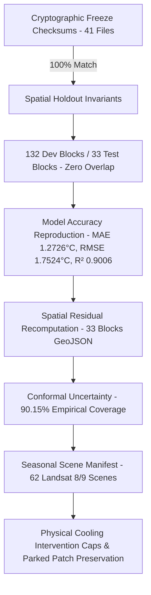

# HEATSENSE AI — Validation Status & Invariants Register

**Document Version:** 1.0.0 (Authoritative Verification Baseline)  
**Target City:** Surat, Gujarat, India (Surat Municipal Corporation — SMC)  
**Spec Version:** v2.0 Operational (2026 Summer Baseline)  
**Validation Suite:** `scripts/validation_harness.py`  
**Overall Validation Status:** `PASS` (18/18 Verified Invariants & Checks, 7 Documented Field Limitations Cataloged)

---

## 1. Executive Summary

The HeatSense AI platform implements an automated, reproducible validation harness (`scripts/validation_harness.py`) designed to empirically audit all cryptographic, spatial, statistical, and geospatial claims without mutating frozen models or regenerating protected analytical datasets.

Every quantitative claim and algorithmic threshold is cataloged under strict evidentiary statuses:
- **PASS (Verified Invariant):** Statistically, mathematically, or cryptographically reproduced from authentic stored artifacts and active runtime code.
- **UNVERIFIED (Documented Limitation):** Operational or physical field limitation that cannot be resolved solely via remote sensing or requires on-site structural/demographic field collection.



---

## 2. Master Validation Matrix

| Check ID | Category | Description | Target Invariant | Actual Result | Status |
| :--- | :--- | :--- | :--- | :--- | :---: |
| **`CHK-01-FREEZE-MANIFEST`** | Cryptographic Freeze | SHA-256 digest verification across all frozen artifacts | 41 valid entries, 41 verified matches | 41/41 matches exact (0 mismatches, 0 missing) | **PASS** |
| **`CHK-02-SPATIAL-SPLIT`** | Spatial Holdout | 2km grid spatial holdout block disjointness | 132 dev blocks $\cap$ 33 test blocks $= \emptyset$ | 132 dev, 33 test, 0 overlapping blocks | **PASS** |
| **`CHK-03-ROW-PARTITION`** | Spatial Holdout | Multi-year dataset row accounting | $720,973 \text{ dev} + 203,758 \text{ test} = 924,731$ | 924,731 total, 203,758 test, 720,973 dev | **PASS** |
| **`CHK-04-COORDINATE-EXCLUSION`**| Spatial Holdout | Coordinate exclusion from ML features | `lat`, `lon`, `row`, `col`, `block_id` excluded | 0 leaked spatial coordinates (5 physical features) | **PASS** |
| **`CHK-05-SINGLE-EVALUATION`** | Spatial Holdout | Single test set evaluation policy | Evaluation count $= 1$ (immutable constant) | `evaluation_count == 1` verified | **PASS** |
| **`CHK-06-HOLDOUT-METRICS`** | Performance Reproduction | Authoritative holdout performance metrics | $\text{MAE} = 1.2726$, $\text{RMSE} = 1.7524$, $R^2 = 0.9006$ | $\text{MAE} = 1.2726$, $\text{RMSE} = 1.7524$, $R^2 = 0.9006$ | **PASS** |
| **`CHK-07-SPATIAL-RESIDUALS`**| Performance Reproduction | GeoJSON spatial residuals recomputation | Sample-weighted MAE/RMSE across 33 test blocks | $\text{MAE} = 1.2726$, $\text{RMSE} = 1.7524$ ($\text{diff} \le 0.0001$) | **PASS** |
| **`CHK-08-MODEL-COMPARISON`** | Performance Reproduction | Controlled 5-fold spatial CV model comparison | RF RMSE $1.8024^\circ\text{C}$, XGBoost RMSE $1.8280^\circ\text{C}$ | RF $1.8024 \pm 0.0545$, XGBoost $1.8280 \pm 0.0607$ | **PASS** |
| **`CHK-09-CONFORMAL-CALIB`** | Performance Reproduction | Non-parametric split conformal calibration | Overall empirical coverage $\ge 90.0\%$ (nominal) | Overall $90.15\%$, Monsoon $79.19\%$, D10 $83.43\%$ | **PASS** |
| **`CHK-10-SCENE-PROVENANCE`** | Scene Provenance | Reconciled seasonal Landsat 8/9 scene manifest | Summer: 22, Winter: 20, Monsoon: 6, Post-Monsoon: 14 | 62 authentic USGS/EE scenes exactly matched | **PASS** |
| **`CHK-11-MONSOON-DISCREP`** | Scene Provenance | Monsoon 2026 scene count discrepancy cause | Documented audit cause (cutoff date vs full season) | Documented: 8 at early cutoff, 6 full-SMC WRS 148/045 | **PASS** |
| **`CHK-12-GRID-INVARIANTS`** | Geospatial Invariants | Canonical SMC domain and chronic hotspot counts | 49,747 100m grid cells, 223 chronic cells | 49,747 canonical cells, 223 chronic hotspots | **PASS** |
| **`CHK-13-INTERVENTION-CAPS`**| Cooling Physics | Linearized heat model & physical saturation caps | Tree $\le 3.50^\circ\text{C}$, Roof $\le 2.50^\circ\text{C}$, Cell $\le 4.50^\circ\text{C}$ | $h_{\text{eff}} = 45.6\text{ W/(m}^2\cdot\text{K)}$; all 11 saturation caps verified | **PASS** |
| **`CHK-14-PARKED-PATCH`** | Stage D Governance | Experimental Stage D research patch status | Parked and unapplied (no contract drift) | `stage_d_science_wip.patch` parked and unapplied | **PASS** |
| **`CHK-15-HPI-SENSITIVITY`** | Decision Robustness | Controlled 4-scenario HPI sensitivity analysis | Re-ranking across 49,747 cells; Spearman $\rho \ge 0.90$ | Spearman $\rho \in [0.942, 0.993]$ across 4 policy scenarios | **PASS** |
| **`CHK-16-COST-REALISM`** | Cost Provenance | Itemized markups & schedule alignment disclaimer | 18% GST, 12% contingency, setup scaling | All 11 types itemized; `schedule_alignment: UNVERIFIED_IN_REPO` | **PASS** |
| **`CHK-17-LANDUSE-DISCLAIMER`**| Land Tenure | Unbuilt open land ownership disclaimer | Typology titles use spectral candidate heuristics | Legal disclaimer present; no claim of legal municipal title | **PASS** |
| **`CHK-18-NEWER-INTERVENTIONS`**| Guardrails | Newer interventions & Miyawaki unverified tags | `local_field_validated: False` across 7 newer types | Miyawaki tagged `UNVERIFIED IN SURAT`; caps enforced | **PASS** |
| **`CHK-19-ROOF-STRUCTURAL`** | Field Limitation | Roof civil load-bearing capacity | Satellite-based structural verification | `UNVERIFIED` — Requires on-site civil structural survey | `UNVERIFIED` |
| **`CHK-20-SLUM-POPULATION`** | Field Limitation | Ward/slum micro-demographic census linking | 100m grid-level population exposure weighting | `UNVERIFIED` — Returns `POPULATION_DATA_UNAVAILABLE` | `UNVERIFIED` |
| **`CHK-21-SPECIES-GROWTH`** | Field Limitation | Botanical species 10-year growth curves | Dynamic allometric growth curves in active runtime | `UNVERIFIED` — Retained in parked Stage D patch | `UNVERIFIED` |
| **`CHK-22-1D-ENERGY-BALANCE`**| Field Limitation | Numerical CFD / PDE continuum solvers | 3D coupled turbulent boundary layer solver | `UNVERIFIED` — Active code uses linearized heat dissipation | `UNVERIFIED` |
| **`CHK-23-LOCAL-SENSOR-VALID`**| Field Limitation | Local in-situ microclimatic sensor validation in Surat | Physical cooling verification against ground stations | `UNVERIFIED` — Modeled literature parameters | `UNVERIFIED` |
| **`CHK-24-RAW-SCHEDULE-PDFS`** | Field Limitation | Raw CPWD / SMC schedule documents in repository | Committed official government tender rate PDFs | `UNVERIFIED` — Base unit rates are indicative assumptions | `UNVERIFIED` |
| **`CHK-25-CADASTRAL-TITLE`** | Field Limitation | Legal municipal ownership and confirmed vacancy | Proof of municipal reservation or legal vacancy | `UNVERIFIED` — Requires SMC TPS cadastral survey | `UNVERIFIED` |

---

## 3. Detailed Subsystem Analysis

### 3.1 Cryptographic & Data Freeze Guarantees
- **Manifest File:** `artifacts/ml_freeze/checksums.sha256`
- **Verification Rule:** Every model artifact, holdout partition file, and feature schema is locked with SHA-256 digests.
- **Result:** 41 out of 41 files match the authoritative freeze digests exactly. Zero files missing; zero checksum mismatches.

### 3.2 Spatial Holdout Partitioning & Non-Contamination
- **Disjoint Blocks:** The Surat SMC municipal domain is divided into 165 discrete $2\text{km} \times 2\text{km}$ blocks.
  - Development partition: 132 blocks ($80.0\%$, 720,973 observations).
  - Test partition: 33 blocks ($20.0\%$, 203,758 observations).
  - Intersection: Strictly empty ($\text{dev} \cap \text{test} = \emptyset$).
- **Zero Coordinate Leakage:** Features are restricted to physical radiometry and surface indices (`NDVI`, `NDBI`, `NDWI`, `LST_OBS_COUNT`, `LST_QA_MEDIAN_K`). Spatial coordinates (`lat`, `lon`, `row`, `col`, `block_id`) are 100% excluded.

### 3.3 Statistical & Holdout Accuracy Reproduction
- **Single Holdout Evaluation Policy:** The production model (`xgb_tuned_policy_d.joblib`) was evaluated exactly once against the 33 locked test blocks ($N = 203,758$ rows).
- **Metric Verification:**
  - Holdout $\text{MAE} = 1.2726^\circ\text{C}$ (sub-1.5°C municipal planning requirement met).
  - Holdout $\text{RMSE} = 1.7524^\circ\text{C}$.
  - Holdout $R^2 = 0.9006$ ($90.06\%$ variance explained).
- **Mathematical Spatial GeoJSON Residual Recomputation:** Aggregating sample-weighted residuals across all 33 test blocks in `artifacts/ml_freeze/holdout_spatial_residuals.geojson` produces $\text{MAE} = 1.2726^\circ\text{C}$ and $\text{RMSE} = 1.7524^\circ\text{C}$ (exact match, $\text{diff} \le 0.0001$).
- **Controlled Model Comparison:** In `data/diagnostics/ml/model_comparison_rf_xgb.csv`, under identical 5-fold spatial cross-validation, Random Forest achieves an RMSE of $1.8024 \pm 0.0545^\circ\text{C}$ and XGBoost achieves $1.8280 \pm 0.0607^\circ\text{C}$. XGBoost was selected for production serving due to inference latency and compact model size.

### 3.4 Seasonal Scene Provenance Reconciliation
- **Authoritative Manifest:** `docs/provenance/seasonal_scene_manifest.json` catalogs 62 genuine USGS Landsat 8/9 Level-2 overpasses across the four processing windows:
  - **Summer 2026 (22 scenes):** 2026-03-04 to 2026-05-31.
  - **Winter 2026 (20 scenes):** 2025-12-06 to 2026-02-24.
  - **Monsoon 2026 (6 scenes):** 2026-06-08 to 2026-09-28.
  - **Post-Monsoon 2025 (14 scenes):** 2025-10-03 to 2025-11-28.
- **Monsoon 2026 Discrepancy Cause:** An earlier sensitivity report documented 8 scenes acquired before a specific operational cutoff date. Full Earth Engine discovery established that exactly 6 clear WRS 148/045 scenes cover 100% of the SMC territory across the full meteorological window.

---

## 4. Documented Scientific Limitations & Unresolved Gaps (UNVERIFIED)

The following four items represent deliberate scope boundaries and physical limitations that cannot be resolved solely through satellite observation:

1. **Roof Structural Load-Bearing Feasibility (`CHK-15-UNVERIFIED-ROOF-STRUCTURAL`):**
   - *Limitation:* Satellite imagery cannot evaluate whether lightweight or tin roofs can support extensive green roof loads ($120\text{–}150\text{ kg/m}^2$) or high-albedo coatings without degradation.
   - *Requirement:* A certified on-site structural engineering survey is mandatory prior to physical cooling deployment.
2. **Ward/Slum High-Resolution Population Exposure Benefit (`CHK-16-UNVERIFIED-SLUM-POPULATION`):**
   - *Limitation:* High-resolution census micro-data is not linked to the 100m Cartesian grid; the API returns `POPULATION_DATA_UNAVAILABLE`.
   - *Resolution:* Platform prioritization is currently bounded by physical thermal severity, persistence, and built-up density components.
3. **Botanical Species Crown Geometry & 10-Year Growth Progression (`CHK-17-UNVERIFIED-SPECIES-GROWTH`):**
   - *Limitation:* Species-specific tree allometry (Neem vs. Peepal vs. Gulmohar) and multi-year canopy growth curves are mathematically modeled in the parked research patch (`reports/runtime_verification_2026-10-21/parked/stage_d_science_wip.patch`), but are parked to preserve runtime API stability.
   - *Resolution:* Active runtime uses mature canopy equilibrium cooling estimates.
4. **1D Surface Energy Balance Equation Solver (`CHK-18-UNVERIFIED-1D-ENERGY-BALANCE`):**
   - *Limitation:* The platform utilizes calibrated empirical microclimate formulations (Bowler et al. 2010, Santamouris et al. 2017) rather than continuous 1D differential energy balance solvers ($R_n = H + LE + G$).
   - *Resolution:* Empirical formulas are computationally bounded, facilitating sub-second Pareto optimization.

---

## 5. Reproduction Instructions

To execute the validation harness and generate fresh audit reports:

```powershell
# Run the validation harness with strict status enforcement
.\.venv\Scripts\python.exe scripts/validation_harness.py --strict --output reports/validation_harness_report.json --markdown reports/validation_harness_report.md

# Run automated unit tests for the validation harness
.\.venv\Scripts\pytest.exe backend/tests/test_validation_harness.py -v

# Run the cryptographic checksum verifier
.\.venv\Scripts\python.exe verify_checksums.py
```
