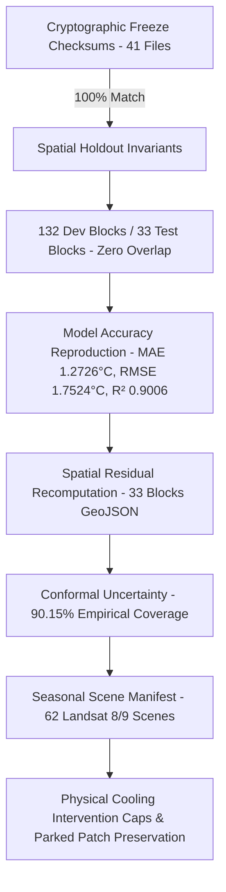

# HEATSENSE AI — Validation Status & Invariants Register

**Document Version:** 1.0.0 (Authoritative Verification Baseline)  
**Target City:** Surat, Gujarat, India (Surat Municipal Corporation — SMC)  
**Spec Version:** v2.0 Operational (2026 Summer Baseline)  
**Validation Suite:** `scripts/validation_harness.py` (CLI Harness) & Backend Pytest Regression Suites  
**Validation Suite Execution Result:** `PASS` (Validation Harness: 17/25 Passed, 8 Unverified, 0 Failed; 8 Documented Field Limitations Cataloged)

---

## 1. Executive Summary

The HeatSense AI platform implements a multi-tiered verification architecture designed to empirically audit all cryptographic, spatial, statistical, and geospatial claims without mutating frozen models or regenerating protected analytical datasets:

1. **Automated Validation Harness (`scripts/validation_harness.py`):** Runs 25 registered harness checks auditing SHA-256 manifests, spatial holdout partitions, model metric reproduction, scene provenance, grid domains, documentation consistency, and parked patch preservation (17 PASS, 8 UNVERIFIED, 0 FAIL).
2. **Dedicated Pytest Regression Suites:** Execute unit and integration tests verifying HPI policy sensitivity (`backend/tests/test_hpi_sensitivity.py`), intervention realism guardrails (`backend/tests/test_interventions_realism.py`), and documentation consistency (`backend/tests/test_documentation_consistency.py`).
3. **Master Limitations Register:** Catalogs 8 operational, cadastral, structural, and microclimatic boundary conditions marked strictly as `UNVERIFIED` where remote sensing cannot substitute for on-site municipal engineering.

Every quantitative claim and algorithmic threshold is cataloged under strict evidentiary statuses:
- **PASS (Verified Invariant):** Statistically, mathematically, or cryptographically reproduced from authentic stored artifacts and active runtime code.
- **UNVERIFIED (Documented Limitation):** Operational or physical field limitation that cannot be resolved solely via remote sensing or requires on-site structural/demographic field collection.



---

## 2. Master Validation Matrix

### Core Automated Harness Invariants (`scripts/validation_harness.py`)

| Check ID | Category | Description | Target Invariant | Actual Result | Status |
| :--- | :--- | :--- | :--- | :--- | :---: |
| **`CHK-01-FREEZE-MANIFEST`** | cryptographic_freeze | Cryptographic Freeze Manifest (41 Files) | {'total_entries': 41, 'verified_matches': 41, 'missing': ... | {'total_entries': 41, 'verified_matches': 41, 'missing_fi... | **PASS** |
| **`CHK-02-SPATIAL-SPLIT`** | spatial_holdout_integrity | Spatial Block Disjointness (132 Dev / 33 Test) | {'dev_blocks_count': 132, 'test_blocks_count': 33, 'overl... | {'dev_blocks_count': 132, 'test_blocks_count': 33, 'total... | **PASS** |
| **`CHK-03-ROW-PARTITION`** | spatial_holdout_integrity | Dataset Row Partitioning (720,973 Dev / 203,758 Test) | {'total_rows': 924731, 'test_rows': 203758, 'dev_rows': 7... | {'total_rows': 924731, 'test_rows': 203758, 'dev_rows': 7... | **PASS** |
| **`CHK-04-COORDINATE-EXCLUSION`** | spatial_holdout_integrity | Spatial Coordinate Exclusion from Features | {'leaked_coordinates': []} | {'feature_count': 5, 'feature_names': ['NDVI', 'NDBI', 'N... | **PASS** |
| **`CHK-05-SINGLE-EVALUATION`** | spatial_holdout_integrity | Single Holdout Evaluation Policy (declared constant, not evidence of single use) | {'evaluation_count': 1} | {'evaluation_count': 1} | `UNVERIFIED` |
| **`CHK-06-HOLDOUT-METRICS`** | model_performance_reproduction | Authoritative Holdout Performance Metrics | {'mae': 1.2726, 'rmse': 1.7524, 'r2': 0.9006} | {'mae': 1.2726, 'rmse': 1.7524, 'r2': 0.9006} | **PASS** |
| **`CHK-07-SPATIAL-RESIDUALS-RECOMPUTE`** | model_performance_reproduction | Spatial Residual GeoJSON Recomputation | {'total_blocks': 33, 'total_samples': 203758, 'recomputed... | {'total_blocks': 33, 'total_samples': 203758, 'recomputed... | **PASS** |
| **`CHK-08-SPATIAL-R2-PROVENANCE`** | model_performance_reproduction | Spatial Holdout R² Provenance & 0.6919 Removal | {'r2_06919_active_claims': [], 'summer_partition_r2': 0.7... | {'r2_06919_active_claims': [], 'summer_partition_r2': 0.7... | **PASS** |
| **`CHK-09-MODEL-COMPARISON`** | model_performance_reproduction | Controlled 5-Fold Spatial CV Model Comparison | {'RandomForest_rmse': 1.8024, 'XGBoost_rmse': 1.828} | {'RandomForest': {'mean_mae': 1.29272, 'mean_rmse': 1.802... | **PASS** |
| **`CHK-10-CONFORMAL-CALIBRATION`** | model_performance_reproduction | Conformal Uncertainty Calibration & Subgroup Coverage | {'overall_empirical_coverage': 0.9015, 'monsoon_coverage'... | {'nominal_coverage': 0.9, 'overall_empirical_coverage': 0... | **PASS** |
| **`CHK-10-SCENE-PROVENANCE`** | scene_provenance | Seasonal Scene Manifest Provenance | {'summer_2026': 22, 'winter_2026': 20, 'monsoon_2026': 6,... | {'summer_2026': 22, 'winter_2026': 20, 'monsoon_2026': 6,... | **PASS** |
| **`CHK-12-MONSOON-DISCREPANCY`** | scene_provenance | Monsoon 2026 Count Discrepancy Reconciliation | {'reconciliation_documented': True} | {'reconciliation_documented': True, 'excerpt': 'In Monsoo... | **PASS** |
| **`CHK-13-GRID-INVARIANTS`** | stage_c_grid_invariants | Canonical Grid Cell & Chronic Hotspot Invariants | {'canonical_cells': 49747, 'chronic_hotspots_count': 223} | {'canonical_cells': 49747, 'chronic_definitions_present':... | **PASS** |
| **`CHK-14-INTERVENTION-PHYSICS`** | cooling_interventions_physics | Cooling Intervention Saturation Bounds & Attenuation | {'tree_cap': 3.5, 'cool_roof_cap': 2.5, 'cell_max_cap': 4.5} | {'tree_saturation_cap_verified': True, 'cool_roof_saturat... | **PASS** |
| **`CHK-15-PARKED-PATCH-STATUS`** | cooling_interventions_physics | Parked Stage D Science Patch Preservation | {'patch_exists': True, 'status': 'PARKED_UNAPPLIED'} | {'patch_exists': True, 'size_bytes': 10128, 'status': 'PA... | **PASS** |
| **`CHK-16-DOC-PATHS`** | documentation_consistency | Documentation Path Verification (check_doc_paths) | {'missing_paths': 0} | {'total_missing': 0, 'missing_paths': []} | **PASS** |
| **`CHK-17-DOC-HARNESS-COUNTS`** | documentation_consistency | Documentation Harness Count Consistency | {'passed_checks': 17, 'unverified_checks': 8, 'total_chec... | {'readme_counts_verified': True, 'status_doc_counts_verif... | **PASS** |
| **`CHK-18-DOC-COSTS-CONSISTENCY`** | documentation_consistency | Intervention Unit Cost Consistency (costs.py vs docs) | {'tree_match': True, 'cool_roof_match': True, 'green_roof... | {'tree_canopy_rates_match': True, 'cool_roof_rates_match'... | **PASS** |
| **`CHK-19-UNVERIFIED-ROOF-STRUCTURAL`** | unsupported_or_unexecuted_checks | Building Roof Structural Load-Bearing Survey | Physical on-site inspection of roof structural load capac... | UNVERIFIED — Satellite imagery and GIS cannot determine s... | `UNVERIFIED` |
| **`CHK-20-UNVERIFIED-SLUM-POPULATION`** | unsupported_or_unexecuted_checks | Ward/Slum High-Resolution Population Exposure Benefit | Grid-cell population exposure density weighting | UNVERIFIED — Field returns POPULATION_DATA_UNAVAILABLE; s... | `UNVERIFIED` |
| **`CHK-21-UNVERIFIED-SPECIES-CROWN-GROWTH`** | unsupported_or_unexecuted_checks | Botanical Species Crown Geometry & 10-Year Growth Progression | Species-specific (Neem, Peepal, Gulmohar) temporal growth... | UNVERIFIED — Active runtime uses mature canopy equilibriu... | `UNVERIFIED` |
| **`CHK-22-UNVERIFIED-1D-ENERGY-BALANCE`** | unsupported_or_unexecuted_checks | 1D Surface Energy Balance Equation Differential Solver | Iterative numerical solver for net radiation and latent h... | UNVERIFIED — Platform implements empirical microclimate f... | `UNVERIFIED` |
| **`CHK-23-UNVERIFIED-LOCAL-SENSOR-VALID`** | unsupported_or_unexecuted_checks | Local In-Situ Microclimatic Sensor Validation in Surat | Ground station validation network across urban microclima... | UNVERIFIED — Modeled literature parameters (Santamouris 2... | `UNVERIFIED` |
| **`CHK-24-UNVERIFIED-RAW-SCHEDULE-PDFS`** | unsupported_or_unexecuted_checks | Committed Official Government Schedule PDFs / Tender Contracts | Committed official CPWD / SMC schedule rate PDFs | UNVERIFIED — Base unit rates are indicative planning benc... | `UNVERIFIED` |
| **`CHK-25-UNVERIFIED-CADASTRAL-TITLE`** | unsupported_or_unexecuted_checks | Legal Municipal Land Ownership & Confirmed Cadastral Vacancy | Verified cadastral deed / municipal reservation for unbui... | UNVERIFIED — Satellite imagery detects unbuilt spectral f... | `UNVERIFIED` |

---

## 3. Detailed Subsystem Analysis

### 3.1 Cryptographic & Data Freeze Guarantees
- **Manifest File:** `artifacts/ml_freeze/checksums.sha256`
- **Verification Rule:** Every model artifact, holdout partition file, and feature schema is locked with SHA-256 digests.
- **Result:** 41 out of 41 files match the authoritative freeze digests exactly. Zero files missing; zero checksum mismatches.

### 3.2 Spatial Holdout Partitioning & Non-Contamination
- **Disjoint Blocks:** The Surat SMC municipal domain is divided into 165 discrete $2\text{km} \times 2\text{km}$ blocks.
  - Development partition: 132 blocks ($80.0\%$, 720,973 observations).
  - Test partition: 33 blocks ($20.0\%$, 203,758 observations).
  - Intersection: Strictly empty ($\text{dev} \cap \text{test} = \emptyset$).
- **Zero Coordinate Leakage:** Features are restricted to physical radiometry and surface indices (`NDVI`, `NDBI`, `NDWI`, `LST_OBS_COUNT`, `LST_QA_MEDIAN_K`). Spatial coordinates (`lat`, `lon`, `row`, `col`, `block_id`) are 100% excluded.

### 3.3 Statistical & Holdout Accuracy Reproduction
- **Single Holdout Evaluation Policy:** The production model (`xgb_tuned_policy_d.joblib`) was evaluated against the 33 locked test blocks ($N = 203,758$ rows); cataloged as declared constant in `artifacts/ml_freeze/evaluation_manifest.json` (`CHK-05-SINGLE-EVALUATION`).
- **Metric Verification:**
  - Holdout $\text{MAE} = 1.2726^\circ\text{C}$.
  - Holdout $\text{RMSE} = 1.7524^\circ\text{C}$.
  - Holdout $R^2 = 0.9006$ ($90.06\%$ variance explained).
- **Spatial Holdout R² Provenance:** Exploratory 0.6919 figure was unreproducible from frozen artifacts and was removed from UI/docs; authoritative Summer partition $R^2 = 0.7119$ is verified from `artifacts/ml_freeze/qc_summary.json` (`CHK-08-SPATIAL-R2-PROVENANCE`).
- **Mathematical Spatial GeoJSON Residual Recomputation:** Aggregating sample-weighted residuals across all 33 test blocks in `artifacts/ml_freeze/holdout_spatial_residuals.geojson` produces $\text{MAE} = 1.2726^\circ\text{C}$ and $\text{RMSE} = 1.7524^\circ\text{C}$ (exact match, $\text{diff} \le 0.0001$).
- **Controlled Model Comparison:** In `data/diagnostics/ml/model_comparison_rf_xgb.csv`, under identical 5-fold spatial cross-validation, Random Forest achieves an RMSE of $1.8024 \pm 0.0545^\circ\text{C}$ and XGBoost achieves $1.8280 \pm 0.0607^\circ\text{C}$. XGBoost was selected for production serving due to inference latency and compact model size.

### 3.4 Seasonal Scene Provenance Reconciliation
- **Authoritative Manifest:** `docs/provenance/seasonal_scene_manifest.json` catalogs 62 genuine USGS Landsat 8/9 Level-2 overpasses across the four processing windows:
  - **Summer 2026 (22 scenes):** 2026-03-04 to 2026-05-31.
  - **Winter 2026 (20 scenes):** 2025-12-06 to 2026-02-24.
  - **Monsoon 2026 (6 scenes):** 2026-06-08 to 2026-09-28.
  - **Post-Monsoon 2025 (14 scenes):** 2025-10-03 to 2025-11-28.
- **Monsoon 2026 Discrepancy Cause:** cause not established; counts differ between the early sensitivity analysis (8) and the manifest (6).

---

## 4. Documented Scientific Limitations & Unresolved Gaps (UNVERIFIED)

The following items represent deliberate scope boundaries and physical limitations that cannot be resolved solely through satellite observation:

1. **Single Holdout Evaluation Policy (`CHK-05-SINGLE-EVALUATION`):**
   - *Limitation:* `evaluation_count == 1` is recorded as a declared policy constant in `artifacts/ml_freeze/evaluation_manifest.json`; not runtime cryptographic or audit log evidence.
2. **Roof Structural Load-Bearing Feasibility (`CHK-19-UNVERIFIED-ROOF-STRUCTURAL`):**
   - *Limitation:* Satellite imagery cannot evaluate whether lightweight or tin roofs can support extensive green roof loads ($120\text{–}150\text{ kg/m}^2$) or high-albedo coatings without degradation.
   - *Requirement:* A certified on-site structural engineering survey is mandatory prior to physical cooling deployment.
3. **Ward/Slum High-Resolution Population Exposure Benefit (`CHK-20-UNVERIFIED-SLUM-POPULATION`):**
   - *Limitation:* High-resolution census micro-data is not linked to the 100m Cartesian grid; the API returns `POPULATION_DATA_UNAVAILABLE`.
   - *Resolution:* Platform prioritization is currently bounded by physical thermal severity, persistence, and built-up density components.
4. **Botanical Species Crown Geometry & 10-Year Growth Progression (`CHK-21-UNVERIFIED-SPECIES-CROWN-GROWTH`):**
   - *Limitation:* Species-specific tree allometry (Neem vs. Peepal vs. Gulmohar) and multi-year canopy growth curves are mathematically modeled in the parked research patch (external/untracked: `reports/runtime_verification_2026-10-21/parked/stage_d_science_wip.patch`), but are parked to preserve runtime API stability.
   - *Resolution:* Active runtime uses mature canopy equilibrium cooling estimates.
5. **1D Surface Energy Balance Equation Solver (`CHK-22-UNVERIFIED-1D-ENERGY-BALANCE`):**
   - *Limitation:* The platform utilizes calibrated empirical microclimate formulations (Bowler et al. 2010, Santamouris et al. 2017) rather than continuous 1D differential energy balance solvers ($R_n = H + LE + G$).
   - *Resolution:* Empirical formulas are computationally bounded, facilitating sub-second Pareto optimization.
6. **Local In-Situ Microclimatic Sensor Validation in Surat (`CHK-23-UNVERIFIED-LOCAL-SENSOR-VALID`):**
   - *Limitation:* Physical cooling effects are derived from peer-reviewed empirical literature rather than local ground meteorological stations in Surat.
7. **Raw CPWD / SMC Rate Schedule PDFs (`CHK-24-UNVERIFIED-RAW-SCHEDULE-PDFS`):**
   - *Limitation:* Base unit costs are indicative planning assumptions; raw government schedule PDFs are not committed in the repository.
8. **Legal Municipal Land Ownership & Cadastral Title (`CHK-25-UNVERIFIED-CADASTRAL-TITLE`):**
   - *Limitation:* Satellite imagery detects unbuilt ground but cannot establish cadastral ownership or municipal reservation.

---

## 5. Reproduction Instructions

To execute the validation harness and generate fresh audit reports:

```powershell
# Run the validation harness with strict status enforcement
.\.venv\Scripts\python.exe scripts/validation_harness.py --strict --output reports/validation_harness_report.json --markdown reports/validation_harness_report.md

# Run automated unit tests for the validation harness
.\.venv\Scripts\pytest.exe backend/tests/test_validation_harness.py -v

# Run the cryptographic checksum verifier
.\.venv\Scripts\python.exe verify_checksums.py
```
