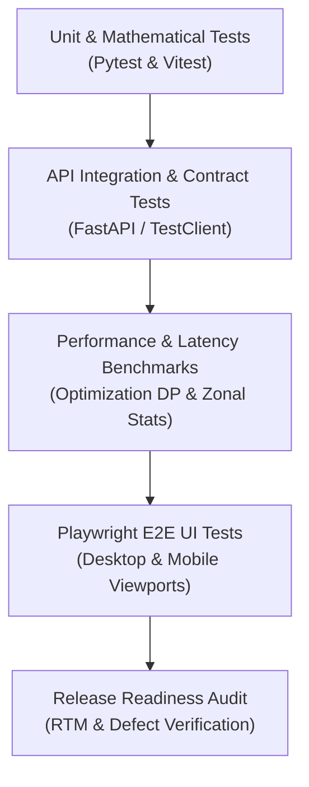

# HEATSENSE AI: Master QA Test Plan
**Document Version:** 1.0.0  
**Date:** October 30, 2026  
**System:** HEATSENSE AI — Stage D Prescriptive Urban Heat Decision Support  
**Scope:** Full QA pass, verification of scientific claims, performance testing, regression test suite, and release qualification for Surat Municipal Corporation (SMC) study domain.

---

## 1. Objectives & Scope

### 1.1 Objectives
1. Verify that all 15 core functional, scientific, and spatial requirements (R1–R15) are strictly satisfied without fabrication or cosmetic hardcoding.
2. Ensure location independence across all recommendation and reasoning logic (Rule 2: zero hardcoded ward, zone, or locality conditionals).
3. Validate physical traceability of all calculations: dynamic geometric quantities, itemized cost markups (CPWD/PWD standards), radiometric skin cooling vs. unmodeled air cooling, and baseline model statistics.
4. Establish an automated Playwright End-to-End (E2E) regression harness testing live frontend views against the running backend stack across three distinct viewports (1366×768, 1920×1080, and 390×844 mobile).
5. Execute end-to-end performance benchmarking and stress testing for combinatorial optimization, GIS raster zonal statistics, and spatial package allocation.

### 1.2 Out of Scope
- Modifying the frozen Stage C Land Surface Temperature (LST) and Heat Priority Index (HPI) baseline models or retraining XGBoost/Random Forest weights.
- Altering production database schemas (`stage_c_grid_cells`, `stage_c_heat_priority_scores`).
- Fabricating unavailable municipal cadastral or topographical layers (cadastral footprints with structural load ratings, road centerlines with right-of-way widths, revenue parcel ownership, and LiDAR DEM). These must be reported as `UNAVAILABLE`.

---

## 2. Test Strategy & Levels

### 2.1 Level 1: Unit & Physics Verification
- **Frameworks:** `pytest` (Backend / GIS engines), `vitest` (Frontend components and math routines).
- **Focus Areas:**
  - Dynamic quantity derivation: $Q = A_{\text{poly}} \times P_{\text{class}} \times f_{\text{usable}}$.
  - Cost markup chain: Direct execution cost + Design (6%) + GST (18%) + Contingency (12%) + Scaled setup.
  - Radiometric surface skin cooling: $\Delta T_{\text{skin}} = -(I_{\text{solar}} \cdot \Delta \alpha) / h_{\text{eff}}$ under peak Surat May irradiance ($870\text{ W/m}^2, h_{\text{eff}} = 45.6\text{ W/m}^2\text{K}$).
  - AST automated code scans asserting zero zone/ward/locality name hardcoding in recommendation modules.
  - Rule execution on synthetic evidence across full matrix of missing, partial, and degraded sensor inputs.

### 2.2 Level 2: Backend API Integration Tests
- **Framework:** `pytest` with FastAPI TestClient and live database connection.
- **Coverage:**
  - `/api/v1/analysis/recommendations`: 7 required response sections, deterministic cache key isolation, and zero-cost/zero-quantity enforcement for rejected candidates.
  - `/api/v1/interventions/optimize`: All algorithms (`greedy`, `nsga2`, `exact_knapsack`) across varying budget levels and spatial scopes with authentication enforcement.
  - `/api/v1/heat-priority/model-validation`: Verification of frozen spatial block cross-validation metrics.

### 2.3 Level 3: Automated End-to-End (E2E) Browser Testing
- **Framework:** Playwright (Node.js `@playwright/test` using Chrome channel).
- **Target Viewports:**
  - Desktop Standard: $1366 \times 768$
  - Desktop Full HD: $1920 \times 1080$
  - Mobile Viewport: $390 \times 844$ (iPhone 14 standard)
- **Scenarios:**
  - Heat Map cell inspector: point selection, full detail rendering, and verification of scrollable flex layout without clipping.
  - Area Analysis: polygon drawing, compact summary card, full-width dedicated analysis view, and back-to-map state preservation.
  - Intervention Explorer: chip filtering, verification that retired types are absent, and proof of zero duplicate cells.
  - Scenario Lab -> Optimization: automatic state forwarding, banner confirmation, and one-click execution.

---

## 3. Environment & Configuration

| Component | Target Version / Runtime | Local Port / Host | Credentials / Notes |
| :--- | :--- | :--- | :--- |
| **Backend** | Python 3.12.10 / FastAPI / Uvicorn | `127.0.0.1:8000` | Local daemon |
| **Frontend** | Node.js v26.3.0 / Vite 7.1.7 / React 19 | `127.0.0.1:5173` | Local dev server |
| **Database** | PostgreSQL 17.4 with PostGIS 3.5 | `127.0.0.1:5433` | User: `heatsense` |
| **Auth Role** | Role: `planner_officer` (JWT Bearer) | `/api/v1/auth/login` | Rate limited (5 req/min) |

---

## 4. Pass / Fail & Suspension Criteria

### 4.1 Pass Criteria
- 100% of RTM requirements (R1–R15) have associated automated or live verified test evidence marked **PASS**.
- Zero critical (P0) or high (P1) defects remaining open in the defect log.
- All backend unit/API tests pass without any skips or weakened assertions.
- Production build (`npm run build`) completes with zero errors or unhandled warnings.
- Playwright E2E suite passes across all 3 viewports.

### 4.2 Suspension Criteria
- Any regression or modification to the frozen Stage C LST/HPI database rows.
- Discovery of hardcoded locality strings in recommendation decision trees.
- API response times exceeding 30 seconds for any optimization or analysis query.
