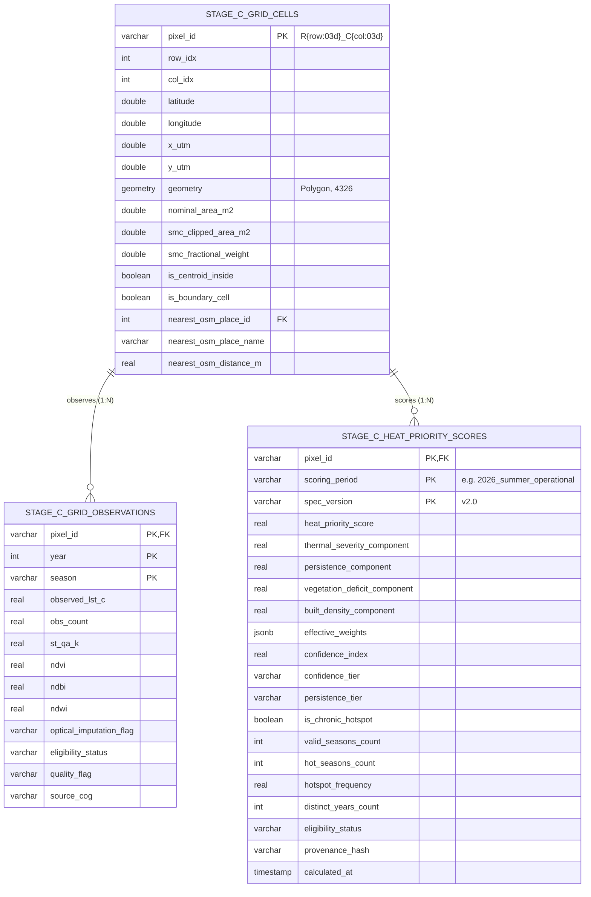

# HEATSENSE AI — Stage C Heat Priority Specification (Final Implementation Specification)

**Project:** HEATSENSE AI — AI-Powered GIS-Based Urban Heat Mitigation & Cooling Decision-Support Platform  
**Target Region:** Surat Municipal Corporation (SMC), Gujarat, India (EPSG:4326 / EPSG:32643)  
**Document Version:** `2.0-FINAL-SPEC-PENDING-APPROVAL`  
**Author:** Senior GIS Engineer, Geospatial Data Architect, Urban Heat Researcher, ML Engineer, PostgreSQL/PostGIS Engineer, Scientific Validation Engineer  
**Date:** 2026-10-04  
**Status:** **SPECIFICATION FINALIZED — SUBMITTED FOR FORMAL APPROVAL GATE (IMPLEMENTATION LOCKED)**  

---

> [!IMPORTANT]
> **Implementation Lock Notice (Phase 4 Approval Gate):**  
> In accordance with the non-negotiable architectural protocols of HEATSENSE AI, this document is a comprehensive specification submitted for formal human review.  
> **Zero production database tables, production HPI scores, production API endpoints, or downstream candidate generation engines may be created until explicit human approval has been granted.**

---

## 1. Scientific Objective, Epistemic Scope, and Guiding Principles

### 1.1 Objective and Purpose
The **Heat Priority Index ($HPI$)** is an objective, biophysical, and urban-form decision-support metric designed for Surat Municipal Corporation (SMC). Its purpose is to prioritize 100 m analytical grid cells where high surface temperatures, persistent multi-year heat recurrence, vegetative canopy deficits, and high built-up surface density create the greatest physical urgency for municipal urban heat mitigation (e.g. urban greening, shaded active mobility corridors, and reflective cool roofs).

### 1.2 Epistemic Boundaries: What Heat Priority Is and Is Not
- **What It Is:**
  - An evidence-based, descriptive biophysical vulnerability index indicating where urban surface morphology and empirical thermal exposure warrant cooling interventions.
  - A multi-criteria synthesis combining ground-truth thermal observations, multi-year recurrence patterns, and physical land-cover conditions.
- **What It Is NOT:**
  1. It is **not** a causal atmospheric thermodynamic model (such as ENVI-met or WRF). It does not compute turbulent heat fluxes, wind corridors, or air temperature advection.
  2. It is **not** a guarantee that modifying land-cover features will yield proportional cooling without site-specific engineering feasibility.
  3. It is **not** a complete socioeconomic vulnerability assessment. It does not integrate census demographic variables (household income, slum populations, age dependency, or health comorbidities), which must be evaluated alongside HPI by city planners.
  4. It does **not** establish intervention feasibility, land-tenure legality, or budgetary feasibility.

### 1.3 Core Epistemic Hierarchy
HEATSENSE AI enforces a strict three-tier epistemic hierarchy:
1. **Tier 1: Grounded Empirical Truth ($LST_{obs}$):** USGS Landsat 8/9 Collection 2 Level-2 Surface Temperature (radiatively compensated, quality-gated via Policy D). This is the **primary anchor** of Heat Priority. Modeled LST is strictly prohibited from overruling observed thermal observations.
2. **Tier 2: Predictive Representation ($LST_{model}$):** Frozen XGBoost regressor (`xgb_tuned_policy_d.joblib`, hash `e1aedd49...`). Evaluates feature attribution via SHAP TreeExplainer and quantifies model residuals ($\epsilon = LST_{obs} - LST_{model}$). *Hard Guardrail:* Model performance on chronic hotspots is weak (RMSE 4.84 °C, $R^2 = 0.21$). Modeled LST must **never** disqualify an empirically verified chronic hotspot.
3. **Tier 3: Counterfactual Projection ($\Delta LST$ vs $\Delta T_{air}$):** Simulates potential cooling under hypothetical land-cover modifications. Always quotes empirical confidence intervals and explicitly distinguishes surface cooling from air cooling.

---

## 2. Spatial Grid, Authoritative Boundary, and Area Reconciliation

### 2.1 Authoritative Boundary Definition
- **Official Vector Boundary File:** `data/raw/boundaries/surat_smc_boundary.geojson`
- **Database Table:** `public.study_areas` (row: `name = "Surat Municipal Corporation"`, `code = "SURAT_SMC"`)
- **Spatial Reference System:** `EPSG:4326` (WGS84 Geodetic)
- **Projected Coordinate System for Area & Metric Distance:** `EPSG:32643` (UTM Zone 43N)
- **Vector Area:**
  - Projected UTM Area: **`461.630791 km²`** ($461,630,790.85\text{ m}^2$)
  - Geodesic Ellipsoidal Area (`ST_Area(geometry::geography)`): **`461.418649 km²`**
  - Geometry Validity: `ST_IsValid = True` (0 self-intersections, 0 invalid rings).

### 2.2 Analytical Raster Grid Specifications
All 19 seasonal analytical COGs (`data/processed/analytical/surat_*_analytical_cog.tif`) share an identical, locked grid geometry:
- **Grid CRS:** `EPSG:4326`
- **Grid Dimensions:** $318 \text{ columns} \times 324 \text{ rows} = 103,032 \text{ bounding grid cells}$
- **Cell Size:** $\Delta \lambda = \Delta \phi = 0.0008983152841195215^\circ$
- **Origin (Top-Left):** $(72.68358795339460^\circ\text{ E}, 21.32420821442920^\circ\text{ N})$
- **Spatial Envelope:** $[72.6835879533946, 21.03315406237448, 72.96925221374461, 21.324208214429202]$
- **Nominal Ground Pixel Size in UTM 32643:** $\approx 93.25\text{ m} \times 99.54\text{ m} \approx 9,282.07\text{ m}^2 = 0.009282\text{ km}^2$ per cell.

### 2.3 Spatial Partitioning and Reconciliation Metrics
1. **Total Authoritative SMC Vector Area:** **`461.630791 km²`**
2. **Footprint Intersecting Cells (`all_touched = True`):** **`50,871 cells`**
3. **Cells Completely Inside Boundary (Interior, $w_{ik} = 1.0$):** **`48,588 cells`**
4. **Boundary-Clipped Perimeter Cells ($0 < w_{ik} < 1.0$):** **`2,283 cells`**
5. **Canonical Study Area Cells (`all_touched = False`, Centroid Inside):** **`49,747 cells`**
6. **Total Nominal Area of All Intersecting Cells (50,871):** **`472.207020 km²`** (+2.29% nominal over-coverage)
7. **Total Nominal Area of Centroid-Inside Cells (49,747):** **`461.772581 km²`** (+0.03% difference from vector polygon)
8. **Sum of Clipped Intersections Across All Intersecting Cells:** **`461.630791 km²`**
   - **Area Conservation Error:** **`0.000000%`** (Exact area conservation to 8 decimal places).
9. **Fractional Overlap Weights ($w_{ik} = A_{ik} / A_{cell}$):** Strictly bounded in **`[0.000009, 1.000000]`**.
10. **Sum of Clipped Intersections for 49,747 Centroid-Inside Cells:** **`459.550167 km²`** (covers 99.55% of the municipal territory).

### 2.4 Fractional Area Allocation and Zonal Aggregation Mechanics
For any administrative polygon $A_k$ (e.g. an official municipal ward or planning zone once ingested into `public.admin_boundaries`):
1. **Geometric Intersection Area:**
   $$A_{i, k} = \text{Area}(\text{cell}_i \cap A_k)$$
2. **Fractional Allocation Weight:**
   $$w_{i, k} = \frac{A_{i, k}}{\text{Area}(\text{cell}_i)} \in [0.0, 1.0]$$
3. **Confidence- and Area-Weighted Zonal HPI:**
   $$HPI_{zone, k} = \frac{\sum_i w_{i, k} \cdot HPI_i \cdot CI_i}{\sum_i w_{i, k} \cdot CI_i}$$
4. **Area Conservation Identity:**
   $$\sum_i w_{i, k} \cdot \text{Area}(\text{cell}_i) \equiv \text{Area}(A_k)$$
   This eliminates edge rasterization artifacts and preserves conservation of total land area.

---

## 3. Mathematical Formulation of Heat Priority Index ($HPI$)

The Heat Priority Index is calculated at the nominal 100 m analytical grid cell level as a bounded continuous scalar $HPI \in [0, 100]$.

### 3.1 Composite Formula
For all eligible cells (`ACCEPT` or `FLAG` with valid thermal evidence):
$$HPI_{raw} = 100.0 \times \left(w_T \cdot T_{norm} + w_P \cdot P_{persist} + w_V \cdot V_{deficit} + w_B \cdot B_{density}\right)$$

### 3.2 Approved Component Weights
The baseline component weights reflect the scientific primacy of observed surface heat and its temporal chronic recurrence:
- **Thermal Severity Weight ($w_T$):** **`0.40`** (Primary current thermal stress)
- **Multi-Year Persistence Weight ($w_P$):** **`0.30`** (Multi-season recurrence / chronic heat accumulation)
- **Vegetation Deficit Weight ($w_V$):** **`0.15`** (Canopy deficit / urban greenery deficiency)
- **Built-Up Density Weight ($w_B$):** **`0.15`** (Impervious surface / built morphology density)
- **Weight Conservation:** $w_T + w_P + w_V + w_B = 0.40 + 0.30 + 0.15 + 0.15 \equiv 1.00$.

### 3.3 Component Definitions and Normalization Functions

#### 1. Thermal Severity Component ($T_{norm} \in [0.0, 1.0]$)
Measures the magnitude of observed peak summer land surface temperature:
$$T_{norm} = \text{clamp}\left(\frac{LST_{obs, summer} - T_{min}}{T_{max} - T_{min}}, 0.0, 1.0\right)$$
- **Operational Bounds:**
  - **$T_{min} = 30.0\text{ °C}$** (Cool thermal baseline; lower 0.1% percentile of summer surfaces, representing water bodies and wet vegetation).
  - **$T_{max} = 50.0\text{ °C}$** (Upper thermal ceiling; 99th percentile of summer urban surfaces in Surat, beyond which extreme industrial roofs lie).
- **Clipping Behavior:**
  - If $LST_{obs, summer} < 30.0\text{ °C} \implies T_{norm} = 0.0$.
  - If $LST_{obs, summer} > 50.0\text{ °C} \implies T_{norm} = 1.0$.
- **Missing Data Rule:** If summer observed LST is missing, $T_{norm} = \text{NULL}$, and the cell is ineligible for primary HPI.

#### 2. Multi-Year Persistence Component ($P_{persist} \in [0.0, 1.0]$)
Measures the empirical frequency of a cell exceeding the seasonal 90th percentile ($P_{90}$) across multi-year seasonal composites:
$$P_{persist} = \text{clamp}\left(\frac{N_{hot\_seasons}}{N_{valid\_seasons}}, 0.0, 1.0\right)$$
- **Seasonal $P_{90}$ Threshold:** Calculated independently for each seasonal composite $s$ across all valid on-land Surat pixels.
- **Minimum Temporal Support Requirement:** A cell must possess at least $N_{valid\_seasons} \ge 4$ across the multi-year archive. Cells with $N_{valid\_seasons} < 4$ receive $P_{persist} = 0.0$ and a confidence penalty (`UNVERIFIED_TEMPORAL_SUPPORT`).
- **No Inferred Cooling:** An unobserved season (e.g. cloudy monsoon pass) is omitted from both numerator and denominator; it is **never** treated as a cool season.

#### 3. Vegetation Deficit Component ($V_{deficit} \in [0.0, 1.0]$)
Quantifies the absence of vegetative cooling potential derived from Landsat NDVI:
$$V_{deficit} = \text{clamp}\left(\frac{\text{NDVI}_{target} - \text{NDVI}}{\text{NDVI}_{target} - \text{NDVI}_{min}}, 0.0, 1.0\right)$$
- **Operational Bounds:**
  - **$\text{NDVI}_{min} = 0.05$** (Minimum vegetated threshold; paved asphalt, bare soil, and concrete roofs fall $\le 0.05$).
  - **$\text{NDVI}_{target} = 0.45$** (Optimal urban canopy threshold; healthy parks and dense tree canopies achieve $\ge 0.45$).
- **Clipping Behavior:**
  - If $\text{NDVI} \ge 0.45 \implies V_{deficit} = 0.0$ (Ample vegetation, zero deficit).
  - If $\text{NDVI} \le 0.05 \implies V_{deficit} = 1.0$ (Severe vegetation deficit).

#### 4. Built-Up Density Component ($B_{density} \in [0.0, 1.0]$)
Quantifies impervious built surface intensity derived from Landsat NDBI:
$$B_{density} = \text{clamp}\left(\frac{\text{NDBI} - \text{NDBI}_{min}}{\text{NDBI}_{max} - \text{NDBI}_{min}}, 0.0, 1.0\right)$$
- **Operational Bounds:**
  - **$\text{NDBI}_{min} = -0.25$** (Pervious/vegetated baseline; open fields and water fall $\le -0.25$).
  - **$\text{NDBI}_{max} = 0.15$** (Dense urban core ceiling; highly compacted residential and commercial roofs reach $\ge 0.15$).
- **Clipping Behavior:**
  - If $\text{NDBI} \le -0.25 \implies B_{density} = 0.0$ (Zero built-up stress).
  - If $\text{NDBI} \ge 0.15 \implies B_{density} = 1.0$ (Maximum built-up density).

---

## 4. Hotspot Persistence & Chronic-Hotspot Classification Rules

Stage C eliminates all ambiguity between integer season counts and normalized recurrence frequencies, establishing an auditable multi-year standard.

### 4.1 Canonical Recurrence Frequency Tiers
The normalized recurrence frequency $f_{hot} = N_{hot\_seasons} / N_{valid\_seasons}$ defines five canonical persistence tiers:

| Tier Name | Frequency Condition | Physical Interpretation |
|---|---|---|
| **`chronic_hotspot`** | $f_{hot} \ge 0.50$ ($N_{valid} \ge 4$) | Active in $\ge 50\%$ of valid observed seasons across multiple years |
| **`frequent_hotspot`** | $0.25 \le f_{hot} < 0.50$ | Active in $25\%\text{–}50\%$ of valid observed seasons |
| **`occasional_hotspot`** | $0.10 \le f_{hot} < 0.25$ | Active in $10\%\text{–}25\%$ of valid observed seasons |
| **`transient_extreme`** | $0.0 < f_{hot} < 0.10$ | Episodic single-season spike |
| **`non_hotspot`** | $f_{hot} = 0.0$ | Never exceeded seasonal $P_{90}$ |

### 4.2 Multi-Year Chronic-Hotspot Verification Rule
To be formally classified as `is_chronic_hotspot = True`, a cell **must satisfy all six conditions**:
1. Normalized recurrence frequency: $f_{hot} \ge 0.50$.
2. Minimum qualifying hot seasons: $N_{hot\_seasons} \ge 3$.
3. **Multi-Year Distribution:** Qualifying hot seasons must span **at least two (2) distinct calendar years** (e.g. hot in Summer 2023 and Summer 2024; four hot passes within a single calendar year strictly cannot satisfy this rule).
4. Minimum valid archive support: $N_{valid\_seasons} \ge 4$.
5. Temporal observation support: At least two (2) of the qualifying hot seasons must have clear-sky scene count $OBS \ge 2$.
6. Policy D integrity: The cell was never classified as `EXCLUDE` due to spatial anomaly during qualifying seasons.

All supporting counts (`hot_seasons_count`, `valid_seasons_count`, `distinct_years_count`, `summer_hot_count`, `winter_hot_count`, `monsoon_hot_count`, `post_monsoon_hot_count`) are explicitly stored in the database for transparent auditability.

### 4.3 Known Limitation: Season Denominator Discrepancy
- **Specification vs. Implementation**: While Section 3.3.2 and Section 4.1 define recurrence frequency over locally valid seasons ($f_{hot} = N_{hot\_seasons} / N_{valid\_seasons}$), the reference calculation in `scripts/analyze_hotspot_persistence.py:104-105` uses a fixed 19-season denominator (`valid_seasons_count = total_seasons_count = 19`).
- **Impact on Chronic Hotspot Count**: Under the fixed 19-season denominator, 223 cells qualify as chronic hotspots ($f_{hot} \ge 0.50$ or $N_{hot} \ge 4$). If evaluated strictly over locally valid non-null seasons ($N_{valid\_seasons}$), 233 cells meet the threshold.
- **Differing Cells (10 cells)**: The 10 cells that qualify under the variable valid-season denominator but not under the fixed 19-season denominator are:
  `R029_C299`, `R078_C239`, `R104_C174`, `R105_C213`, `R146_C182`, `R146_C185`, `R161_C162`, `R215_C174`, `R242_C188`, `R245_C190`.
- **Operational Status**: Operational scores, database tables, and downstream models remain unchanged based on the authoritative frozen 223 chronic hotspot cells.

---

## 5. Confidence Index ($CI$) & Missing-Data Protocols

Every grid cell receives a companion **Confidence Index** $CI \in [0.0, 1.0]$:
$$CI = C_{obs} \times C_{qa} \times C_{season} \times C_{sentinel}$$

### 5.1 Observation Support Multiplier ($C_{obs}$)
- $OBS \ge 4$: **`1.00`** (Robust temporal median)
- $OBS \in [2, 3]$: **`0.85`** (Moderate clear-sky support)
- $OBS = 1$ (Spatially coherent `FLAG` under Policy D, $\Delta T_{nbr} \le 10^\circ\text{C}$): **`0.60`**
- $OBS < 1$, `NaN`, or non-finite: **`0.00`** (`EXCLUDE`)

### 5.2 Radiometric Uncertainty Multiplier ($C_{qa}$)
Calibrated to Landsat Collection 2 Level-2 Surface Temperature QA in tropical coastal Gujarat:
- **Nominal Clear-Sky Radiative Transfer ($ST\_QA \le 2.50\text{ K}$):** **`1.00`** (Covers typical dry summer/winter passes where median QA is 2.1–2.4 K).
- **Elevated Atmospheric Moisture ($2.50\text{ K} < ST\_QA \le 3.50\text{ K}$):** **`0.80`**.
- **High Moisture / Cloud Fringe ($ST\_QA > 3.50\text{ K}$):** **`0.50`** (Characteristic of monsoon scenes).
- **Missing / NaN QA:** **`0.50`** (Conservative uncertainty penalty).

### 5.3 Seasonal Profile Multiplier ($C_{season}$)
Reflects the seasonal completeness of the cell across the annual thermal cycle:
- **Summer + Winter + Post-Monsoon ($\pm$ Monsoon) [Full profile]:** **`1.00`**
- **Summer + Winter [Dry season complete]:** **`0.90`**
- **Summer + Monsoon [Missing Winter]:** **`0.80`**
- **Summer Only [Missing all other seasons]:** **`0.70`**
- **Winter + Post-Monsoon [Summer completely missing]:** **`0.40`**
- **Monsoon Only [Summer, Winter, Post-Monsoon missing]:** **`0.25`**
- **Zero valid seasons:** **`0.00`**

### 5.4 Optical Sentinel Multiplier ($C_{sentinel}$)
- Clean optical indices ($-1.0 \le \text{index} \le 1.0$): **`1.00`**
- Optical sentinel ($-9999$) with $\ge 4$ valid 8-neighbors (3x3 median imputed): **`0.70`**
- Optical sentinel with $1\text{–}3$ valid neighbors (mean imputed): **`0.50`**
- Optical sentinel with $0$ valid neighbors (neutral fallback): **`0.30`**

### 5.5 Categorical Confidence Tiers
- **`HIGH` ($CI \ge 0.75$):** Full multi-season coverage, $OBS \ge 2$, nominal radiometric QA. Cleared for capital municipal intervention.
- **`MODERATE` ($0.50 \le CI < 0.75$):** Valid summer, minor QA elevation or single-season history. Suitable for preliminary planning.
- **`LOW` ($0.25 \le CI < 0.50$):** High uncertainty ($OBS = 1$ coherent, or missing summer). Flagged with warning badge.
- **`INSUFFICIENT_EVIDENCE` ($CI < 0.25$):** Excluded from priority ranking; displayed as transparent stippled overlay.

---

## 6. Deterministic Optical Sentinel Handling & Downstream Guardrails

### 6.1 Ingestion Contract
Any optical index (`NDVI`, `NDBI`, `NDWI`) value equal to `-9999`, `-9999.0`, `NaN`, or outside physical bounds $[-1.0, 1.0]$ is strictly classified as **Missing Optical Data**, not a physical measurement.

### 6.2 Deterministic 8-Connected Moore Neighborhood Imputation
When a cell possesses valid thermal data but missing optical data:
1. **Candidate Pool:** Valid on-land neighboring cells within the 8-connected Moore window $(r \pm 1, c \pm 1)$ in the **same seasonal composite** that possess clean optical values ($-1.0 \le \text{val} \le 1.0$).
2. **$\ge 4$ Valid Neighbors:** Impute the 3x3 median. Tag: `OPTICAL_IMPUTED_MEDIAN`. Confidence multiplier: $C_{sentinel} = 0.70$.
3. **$1\text{–}3$ Valid Neighbors (Boundary Fringe):** Impute the valid neighbor mean. Tag: `OPTICAL_IMPUTED_BOUNDARY`. Confidence multiplier: $C_{sentinel} = 0.50$.
4. **$0$ Valid Neighbors:** Impute neutral baseline fallback ($\text{NDVI} = 0.20, \text{NDBI} = 0.00, \text{NDWI} = -0.30$). Tag: `OPTICAL_FALLBACK_NEUTRAL`. Confidence multiplier: $C_{sentinel} = 0.30$.

### 6.3 Hard Guardrail: ML Scenario Cooling Disqualification
Cells whose priority score relies on imputed optical data are **strictly disqualified from downstream Machine Learning scenario cooling projections** ($\Delta LST_{model}$). This prevents non-causal decision-tree extrapolation (Stage B sensitivity audit Outcome B).

---

## 7. Missing Summer Data Policy & Supported Seasonal Patterns

### 7.1 Missing Summer Policy
Because urban heat mitigation specifically targets peak summer thermal stress:
1. **Primary Policy (Option 1):** If summer observed LST is missing, the cell receives:
   - `heat_priority_score = NULL`
   - `eligibility_status = "INSUFFICIENT_THERMAL_EVIDENCE"`
   - `confidence_tier = "INSUFFICIENT"` ($CI < 0.25$)
2. **Prohibition of Temperature Substitution:** Missing observed summer LST must **never** be replaced by XGBoost modeled predictions, neighboring temperatures, or winter temperatures.

### 7.2 Supported Seasonal Pattern Matrix

| Pattern ID | Winter | Summer | Monsoon | Post-Monsoon | Primary HPI Eligible? | Confidence Tier | Persistence Evaluated? |
|:---:|:---:|:---:|:---:|:---:|:---:|:---:|:---:|
| **P1** | Yes | Yes | Yes | Yes | **Yes** | `HIGH` ($CI \ge 0.75$) | Yes ($N_{valid} = 4$) |
| **P2** | Yes | Yes | No | Yes | **Yes** | `HIGH` ($CI \ge 0.75$) | Yes ($N_{valid} = 3$) |
| **P3** | Yes | Yes | Yes | No | **Yes** | `HIGH` ($CI \ge 0.75$) | Yes ($N_{valid} = 3$) |
| **P4** | Yes | Yes | No | No | **Yes** | `HIGH` ($CI \ge 0.75$) | Yes ($N_{valid} = 2$) |
| **P5** | No | Yes | Yes | No | **Yes** | `MODERATE` ($0.50 \le CI < 0.75$) | Yes ($N_{valid} = 2$) |
| **P6** | No | Yes | No | No | **Yes** | `MODERATE` ($0.50 \le CI < 0.75$) | Single-season only ($P_{persist}=0$) |
| **P7** | Yes | No | No | Yes | **No** (`score = NULL`) | `LOW` ($0.25 \le CI < 0.50$) | Evaluated for winter baseline only |
| **P8** | No | No | Yes | No | **No** (`score = NULL`) | `INSUFFICIENT` ($CI < 0.25$) | Masked out |
| **P9** | No | No | No | No | **No** (`score = NULL`) | `INSUFFICIENT` ($CI = 0.0$) | Masked out |

---

## 8. Database Architecture & Alembic Migration Design

To avoid duplicating geometry columns and to cleanly decouple spatial geometry, multi-temporal observations, and derived versioned HPI outputs, Stage C establishes a 3-table normalized relational schema:



### 8.1 Schema DDL & Constraints
```sql
-- 1. Master Analytical Grid Cells (Spatial Foundation, 49,747 rows)
CREATE TABLE stage_c_grid_cells (
    pixel_id VARCHAR(16) PRIMARY KEY,
    row_idx INTEGER NOT NULL,
    col_idx INTEGER NOT NULL,
    latitude DOUBLE PRECISION NOT NULL,
    longitude DOUBLE PRECISION NOT NULL,
    x_utm DOUBLE PRECISION NOT NULL,
    y_utm DOUBLE PRECISION NOT NULL,
    geometry GEOMETRY(Polygon, 4326) NOT NULL,
    nominal_area_m2 DOUBLE PRECISION NOT NULL,
    smc_clipped_area_m2 DOUBLE PRECISION NOT NULL,
    smc_fractional_weight DOUBLE PRECISION NOT NULL CHECK (smc_fractional_weight > 0.0 AND smc_fractional_weight <= 1.0),
    is_centroid_inside BOOLEAN NOT NULL,
    is_boundary_cell BOOLEAN NOT NULL,
    nearest_osm_place_id INTEGER REFERENCES osm_places(id),
    nearest_osm_place_name VARCHAR(64),
    nearest_osm_distance_m REAL
);

CREATE INDEX idx_cells_geom ON stage_c_grid_cells USING GIST(geometry);
CREATE INDEX idx_cells_coords ON stage_c_grid_cells(latitude, longitude);

-- 2. Multi-Temporal Observations (924,731 rows)
CREATE TABLE stage_c_grid_observations (
    pixel_id VARCHAR(16) NOT NULL REFERENCES stage_c_grid_cells(pixel_id),
    year INTEGER NOT NULL CHECK (year >= 2022 AND year <= 2026),
    season VARCHAR(16) NOT NULL CHECK (season IN ('winter', 'summer', 'monsoon', 'post_monsoon')),
    observed_lst_c REAL,
    obs_count REAL NOT NULL CHECK (obs_count >= 0.0),
    st_qa_k REAL,
    ndvi REAL,
    ndbi REAL,
    ndwi REAL,
    optical_imputation_flag VARCHAR(32) NOT NULL DEFAULT 'NONE',
    eligibility_status VARCHAR(16) NOT NULL CHECK (eligibility_status IN ('ACCEPT', 'FLAG', 'EXCLUDE')),
    quality_flag VARCHAR(128) NOT NULL,
    source_cog VARCHAR(128) NOT NULL,
    PRIMARY KEY (pixel_id, year, season)
);

CREATE INDEX idx_obs_year_season ON stage_c_grid_observations(year, season);
CREATE INDEX idx_obs_eligibility ON stage_c_grid_observations(eligibility_status);

-- 3. Versioned Heat Priority Outputs (49,747 rows per versioned run)
CREATE TABLE stage_c_heat_priority_scores (
    pixel_id VARCHAR(16) NOT NULL REFERENCES stage_c_grid_cells(pixel_id),
    scoring_period VARCHAR(32) NOT NULL,
    spec_version VARCHAR(16) NOT NULL,
    heat_priority_score REAL CHECK (heat_priority_score >= 0.0 AND heat_priority_score <= 100.0),
    thermal_severity_component REAL CHECK (thermal_severity_component >= 0.0 AND thermal_severity_component <= 1.0),
    persistence_component REAL CHECK (persistence_component >= 0.0 AND persistence_component <= 1.0),
    vegetation_deficit_component REAL CHECK (vegetation_deficit_component >= 0.0 AND vegetation_deficit_component <= 1.0),
    built_density_component REAL CHECK (built_density_component >= 0.0 AND built_density_component <= 1.0),
    effective_weights JSONB NOT NULL,
    confidence_index REAL NOT NULL CHECK (confidence_index >= 0.0 AND confidence_index <= 1.0),
    confidence_tier VARCHAR(32) NOT NULL CHECK (confidence_tier IN ('HIGH', 'MODERATE', 'LOW', 'INSUFFICIENT')),
    persistence_tier VARCHAR(32) NOT NULL,
    is_chronic_hotspot BOOLEAN NOT NULL,
    valid_seasons_count INTEGER NOT NULL,
    hot_seasons_count INTEGER NOT NULL,
    hotspot_frequency REAL NOT NULL,
    distinct_years_count INTEGER NOT NULL,
    eligibility_status VARCHAR(32) NOT NULL,
    provenance_hash VARCHAR(64) NOT NULL,
    calculated_at TIMESTAMP WITH TIME ZONE DEFAULT CURRENT_TIMESTAMP,
    PRIMARY KEY (pixel_id, scoring_period, spec_version)
);

CREATE INDEX idx_hpi_score ON stage_c_heat_priority_scores(heat_priority_score) WHERE heat_priority_score IS NOT NULL;
CREATE INDEX idx_hpi_confidence ON stage_c_heat_priority_scores(confidence_tier);
CREATE INDEX idx_hpi_chronic ON stage_c_heat_priority_scores(is_chronic_hotspot);
```

---

## 9. Frontend Presentation & UI Contracts (React + Leaflet)

In strict accordance with the frozen frontend architecture (`react: ^19.1.1`, `leaflet: ^1.9.4`, `react-leaflet: ^5.0.0`, `tailwindcss: ^4.3.3`):
1. **Primary Layer:** Leaflet TileLayer displaying the official **Observed LST & Heat Priority Index** color ramp (Viridis or Turbo ramp, normalized 0 to 100).
2. **Confidence Overlay:** Toggleable raster overlay that stipples or masks pixels designated as `LOW` confidence or `INSUFFICIENT`.
3. **Model Context Secondary Layer:** Explicit secondary toggle allowing expert users to inspect XGBoost model residuals and SHAP feature attributions.
4. **Mandatory UI Disclaimers:**
   - Monsoon Banner: *"Monsoon thermal composites reflect elevated atmospheric moisture and cloud fringe effects (validation RMSE 2.44 °C)."*
   - Hotspot Performance Disclaimer: *"Chronic hotspot designations are grounded in multi-year observed satellite thermal data ($OBS \ge 1$). XGBoost predictive models exhibit lower explanatory power in extreme heat plumes ($R^2 = 0.21$)."*

---

## 10. Traceability Matrix: Requirements to Implementation to Verification

| Req ID | Requirement Description | Implementation Module | Database Object | Acceptance Test | Verification Evidence |
|:---:|---|---|---|---|---|
| **REQ-C-01** | Authoritative SMC Boundary Identification | `gis/spatial/grid.py` | `public.study_areas` | `test_authoritative_boundary` | 461.63 km² vector match |
| **REQ-C-02** | Exact Spatial Area Conservation | `gis/spatial/grid.py` | `stage_c_grid_cells` | `test_spatial_area_conservation` | $\Delta \text{Area} = 0.000000\%$ |
| **REQ-C-03** | 4-Component HPI Composite Scoring | `gis/heat_priority/scoring.py` | `stage_c_heat_priority_scores` | `test_hpi_bounded_range` | $0.0 \le HPI \le 100.0$ |
| **REQ-C-04** | Observed Thermal Severity Normalization | `gis/heat_priority/lst_priority.py` | `stage_c_heat_priority_scores.thermal_severity_component` | `test_lst_normalization_bounds` | [30, 50] °C clamping |
| **REQ-C-05** | Multi-Year Chronic Hotspot Classification | `gis/heat_priority/persistence.py` | `stage_c_heat_priority_scores.is_chronic_hotspot` | `test_chronic_hotspot_multi_year` | $f \ge 0.50, \text{years} \ge 2$ |
| **REQ-C-06** | Multiplier-Based Confidence Index | `gis/heat_priority/quality.py` | `stage_c_heat_priority_scores.confidence_index` | `test_confidence_index_calibration` | Mathematical exactness |
| **REQ-C-07** | Deterministic Optical Sentinel Imputation | `gis/quality/imputation.py` | `stage_c_grid_observations.optical_imputation_flag` | `test_optical_sentinel_median_imputation` | 8-connected Moore window |
| **REQ-C-08** | Optical Imputed ML Disqualification | `backend/app/services/scenario.py` | Guardrail policy | `test_optical_sentinel_model_disqualification` | Reject $\Delta LST_{model}$ request |
| **REQ-C-09** | Missing Summer Exclusion Policy | `gis/heat_priority/scoring.py` | `stage_c_heat_priority_scores.heat_priority_score` | `test_missing_summer_null_score` | Score is strictly NULL |
| **REQ-C-10** | Normalized Relational Schema & Constraints | `migrations/versions/*_stage_c.py` | 3 new tables + indexes | `test_database_schema_integrity` | Foreign keys & CHECK pass |
| **REQ-C-11** | Protected Artifact Immutability | `scripts/verify_freeze.py` | Disk files | `test_frozen_artifact_immutability` | SHA-256 unchanged |
| **REQ-C-12** | Global Sensitivity Stability | `scripts/run_sensitivity.py` | Parquet evaluation | `test_hpi_weight_sensitivity` | Spearman $\ge 0.97$ |

---

## 11. Comprehensive Acceptance Test Matrix

| Test ID | Test Name | Target Scope | Verification Condition | Tolerance | Test Location |
|:---:|---|---|---|:---:|---|
| **T-01** | `test_authoritative_boundary_selection` | Spatial Boundary | Matches `study_areas` polygon area | $\pm 0.001\text{ km}^2$ | `backend/tests/test_stage_c_spatial.py` |
| **T-02** | `test_spatial_area_conservation` | Vector Overlap | $\sum w_{ik} \cdot \text{Area}(P_i) \equiv \text{Area}(\text{SMC})$ | $< 10^{-6}\%$ | `backend/tests/test_stage_c_spatial.py` |
| **T-03** | `test_grid_dimension_completeness` | Analytical Grid | Exactly 49,747 study area rows populated | Exact integer | `backend/tests/test_stage_c_spatial.py` |
| **T-04** | `test_hpi_bounded_range` | Numerical Range | $\forall \text{ eligible pixels}, 0.0 \le HPI \le 100.0$ | Exact bounds | `backend/tests/test_stage_c_scoring.py` |
| **T-05** | `test_missing_summer_null_score` | Missing Data | Missing summer yields `score = NULL`, $CI < 0.25$ | Strict NULL | `backend/tests/test_stage_c_scoring.py` |
| **T-06** | `test_lst_normalization_clamping` | Thermal Severity | LST $\le 30 \to 0.0$; LST $\ge 50 \to 1.0$ | Exact bounds | `backend/tests/test_stage_c_scoring.py` |
| **T-07** | `test_ndvi_deficit_clamping` | Vegetation Deficit | NDVI $\ge 0.45 \to 0.0$; NDVI $\le 0.05 \to 1.0$ | Exact bounds | `backend/tests/test_stage_c_scoring.py` |
| **T-08** | `test_ndbi_density_clamping` | Built-Up Density | NDBI $\le -0.25 \to 0.0$; NDBI $\ge 0.15 \to 1.0$ | Exact bounds | `backend/tests/test_stage_c_scoring.py` |
| **T-09** | `test_confidence_multi_season_dry` | Confidence Index | Summer+Winter, $OBS \ge 4, QA \le 2.5 \to CI = 0.90$ (`HIGH`) | $\pm 10^{-4}$ | `backend/tests/test_stage_c_confidence.py` |
| **T-10** | `test_confidence_summer_only` | Confidence Index | Summer only, $OBS \ge 4, QA \le 2.5 \to CI = 0.70$ (`MODERATE`) | $\pm 10^{-4}$ | `backend/tests/test_stage_c_confidence.py` |
| **T-11** | `test_confidence_missing_summer` | Confidence Index | Winter+Post-Monsoon only $\to CI \le 0.40$ (`LOW`) | $\pm 10^{-4}$ | `backend/tests/test_stage_c_confidence.py` |
| **T-12** | `test_optical_sentinel_median_imputation`| Optical Imputation | Sentinel with $\ge 4$ valid nbrs imputes median, $C_{sent}=0.70$ | Exact median | `backend/tests/test_stage_c_imputation.py` |
| **T-13** | `test_optical_sentinel_boundary_imputation`| Optical Imputation | Sentinel with $1\text{–}3$ valid nbrs imputes mean, $C_{sent}=0.50$ | Exact mean | `backend/tests/test_stage_c_imputation.py` |
| **T-14** | `test_optical_sentinel_neutral_fallback` | Optical Imputation | Sentinel with $0$ valid nbrs imputes fallback, $C_{sent}=0.30$ | Exact fallback | `backend/tests/test_stage_c_imputation.py` |
| **T-15** | `test_optical_sentinel_ml_disqualification`| ML Guardrail | Imputed cells rejected from $\Delta LST_{model}$ scenario requests | Strict 400 error | `backend/tests/test_stage_c_imputation.py` |
| **T-16** | `test_chronic_hotspot_single_year_rejected`| Persistence Logic| 4 hot seasons in 1 calendar year rejected from chronic | Strict False | `backend/tests/test_stage_c_persistence.py`|
| **T-17** | `test_chronic_hotspot_multi_year_accepted`| Persistence Logic| $f \ge 0.50, N_{hot} \ge 3$, 2 distinct years accepted | Strict True | `backend/tests/test_stage_c_persistence.py`|
| **T-18** | `test_database_schema_constraints` | Database Schema | Foreign keys, unique temporal keys, CHECK constraints enforced| Error on violation| `backend/tests/test_stage_c_db.py` |
| **T-19** | `test_frozen_model_immutability` | Release Safety | Running Stage C verification leaves model hash unchanged | Hash match | `backend/tests/test_stage_c_freeze.py` |
| **T-20** | `test_hpi_global_sensitivity_stability` | Sensitivity Analysis| Spearman rank correlation $\ge 0.97$ across parameter perturbations | $\ge 0.97$ | `backend/tests/test_stage_c_sensitivity.py`|

---

## 12. Known Limitations & Downstream Boundary Declarations

1. **Non-Causality:** High HPI does not prove that adding vegetation or reflective roofs will causally cool the surface by a specific degree without site-specific thermodynamics.
2. **Exclusion of Social Comorbidities:** HPI measures biophysical and land-cover exposure; it does not measure household income, informal settlement density, or age dependency.
3. **Absence of Post-Monsoon 2026:** Post-monsoon 2026 is absent from the Landsat archive by design (production freeze preceded data availability).
4. **Resolution Granularity:** A 100 m analytical grid represents aggregated land surface temperature, not sub-pixel micro-refuges (such as individual street tree canopies).
5. **No Automatic Downstream Execution:** Stage C strictly produces the Heat Priority Index dataset. It does not generate intervention candidates, run NSGA-II optimization, or calculate cooling impacts.

---

## 13. Specification Sign-Off Recommendation

This specification resolves all historical discrepancies, provides exact mathematical and database formulations, and establishes an auditable 20-point acceptance test matrix.

**Current Stage:** **REVISED SPECIFICATION COMPLETE — AWAITING FORMAL APPROVAL GATE.**
