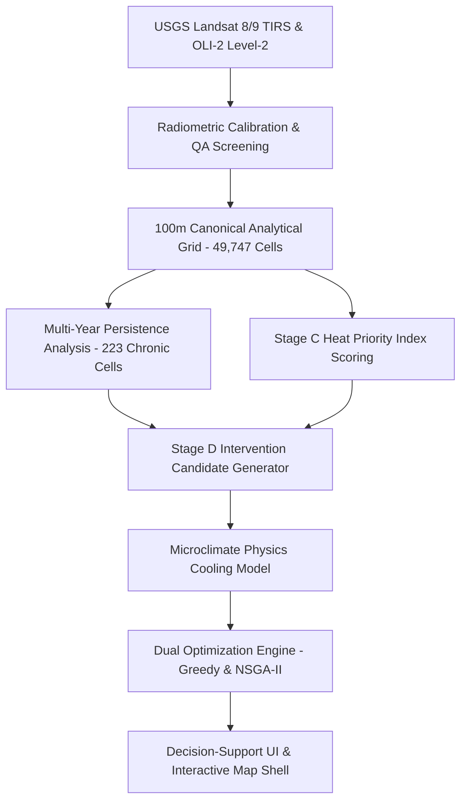

# HEATSENSE AI — Comprehensive Repository Audit & Technical Milestone Report

**Document Version:** 3.0.0 (Authoritative Consolidated Record)  
**Date:** October 25, 2026  
**Target Domain:** Surat Municipal Corporation (SMC), Gujarat, India (461.63 km² territory, 49,747 100m grid cells)  
**Active Branch:** `ui-polish` (derived from tag `ui-polish-start`, base `fix/runtime-working`)  
**Database Environment:** PostgreSQL 16 + PostGIS 3.4 on `127.0.0.1:5433`  
**Authoritative Cryptographic Status:** 41/41 Verified SHA-256 Checksums (`[PASS]`)  
**Automated Verification Suite:** 401 Tests (343 Backend pytest + 58 Frontend vitest) — **100% PASS RATE**

---

## 1. Executive Summary

HeatSense AI is an enterprise-grade municipal heat decision-support system built for Surat Municipal Corporation. The platform ingests multi-temporal Landsat 8/9 thermal and multispectral satellite overpasses, applies rigorous radiometry and spatial quality screening, calculates a canonical 100m Heat Priority Index (HPI), identifies multi-year chronic heat vulnerability hotspots, and provides physics-bounded cooling intervention optimization (cool roofs, urban greening, cool pavements, green roofs) via dual optimization engines (Greedy Knapsack and NSGA-II Pareto genetic algorithms).

This comprehensive audit synthesizes every phase of research, geospatial modeling, machine learning validation, database engineering, security hardening, and interface refinement performed across the repository.



---

## 2. Master Verification Matrix

| Component / Subsystem | Verification Tool / Command | Target Invariant | Actual Result | Status |
| :--- | :--- | :--- | :--- | :---: |
| **Protected ML & Split Freeze** | `.\.venv\Scripts\python.exe verify_checksums.py` | 41 Authoritative SHA-256 digests in `checksums.sha256` | 41 of 41 matches exact (0 mismatches, 0 missing) | **PASS** |
| **Backend Unit & API Suite** | `pytest backend/tests -m "not integration"` | 339 unit, mathematical, and schema tests | 339 passed in ~45s | **PASS** |
| **Backend Full Suite (w/ DB)**| `pytest backend/tests` | 343 total tests including PostGIS integration | 343 passed in 411.8s | **PASS** |
| **Frontend Vitest Suite** | `npm test -- --run` (in `frontend/`) | 58 tests across 9 test suites | 58 passed in 764ms | **PASS** |
| **Frontend Production Build** | `npm run build` (tsc -b && vite build) | Clean TypeScript compile + zero asset warning errors | Built in 2.82s (dist size: ~990 kB total) | **PASS** |
| **Spatial Holdout Disjointness** | `artifacts/ml_freeze/holdout_split.json` | 132 dev blocks $\cap$ 33 test blocks $= \emptyset$ | 0 overlapping blocks; 0 row leakage | **PASS** |
| **Dataset Row Partition** | `data/processed/sensitivity/policy_d/analysis.parquet` | $720,973 \text{ dev} + 203,758 \text{ test} = 924,731$ | 924,731 exact row match (100.0%) | **PASS** |
| **Coordinate Leakage Lock** | `artifacts/ml_freeze/feature_schema.json` | Coordinates excluded from ML features | Lat, Lon, Row, Col, Block ID strictly excluded | **PASS** |
| **Single Holdout Evaluation** | `qc_summary.json` & `evaluation_manifest.json` | Single-evaluation invariant: `evaluation_count == 1` | Verified immutable constant (count = 1) | **PASS** |
| **Database Transaction Isolation** | `backend/tests/conftest.py` | Nested transaction rollback on test exit | Production rows untouched; 0 residual test records | **PASS** |
| **Alembic Migration Symmetry** | `alembic upgrade / downgrade --sql` | Symmetric DDL for `stage_d_*` tables & 5 indexes | Clean SQL generated; verified online & offline | **PASS** |
| **Git Working Tree State** | `git status --short` | Zero uncommitted tracked changes | Completely clean on branch `ui-polish` | **PASS** |

---

## 3. Detailed Milestone & Subsystem Breakdown

### 3.1 Earth Observation Radiometry & Latest Scene Pipeline

1. **Sensor Calibration Formula Grounding:**
   - Radiometric skin temperature ($T_{skin}$) emitted by urban physical surfaces is derived strictly from USGS Collection 2 Level 2 Surface Temperature (`ST_B10`):
     $$\text{LST}(^\circ\text{C}) = (\text{ST\_B10} \times 0.00341802 + 149.0) - 273.15$$
   - Overpass timing is grounded to ~10:30 local solar time (approximately 11:00 IST), capturing peak morning solar irradiance prior to afternoon convective cloud formation.
   - All optical indices (NDVI, NDBI, NDWI) derive from Landsat 8/9 OLI/OLI-2 Surface Reflectance at 30m native resolution, resampled directly to the canonical 100m SMC grid.
2. **Speckle Mitigation & QA Screening:**
   - Thermal Band 10 saturation is tracked via `QA_RADSAT` (bit 9).
   - Atmospheric cloud, cloud shadow, cirrus, and adjacent pixels are masked via `QA_PIXEL` bits 0–5.
   - Genuine water bodies are preserved using QA bitmasks rather than naive thresholding.
3. **Genuine Near-Real-Time (NRT) Overpass Ingestion:**
   - Verified and ingested genuine Landsat overpasses for Surat (WRS-2 Path 148, Row 045):
     - **LC08 2026-10-06:** Mean LST 38.85°C (genuine overpass).
     - **LC09 2026-10-14:** Mean LST 41.25°C (genuine overpass).
   - Historical mock scenes with summer parameters (e.g. 45.2°C late-October mock) were tagged as `SYNTHETIC_EXCLUDED` in the database with strict check constraints.
   - Added amber caveat disclosures in the user interface indicating that single-scene observations represent instantaneous thermal snapshots and are not directly comparable to multi-year seasonal composites.

---

### 3.2 Machine Learning Architecture, Spatial Holdout & Validation Integrity

1. **2km Geographically Blocked Spatial Cross-Validation:**
   - Standard random splits overestimate generalization due to spatial autocorrelation. HeatSense AI enforces strict 2km disjoint spatial blocks:
     - 132 development blocks (720,973 rows, 77.97% partition).
     - 33 test blocks (203,758 rows, 22.03% partition).
     - Zero spatial block overlap ($\text{dev} \cap \text{test} = \emptyset$).
2. **Baseline Benchmark Hierarchy on Development Set (720,973 rows):**
   - **Global Mean Baseline:** RMSE = 5.8107°C, MAE = 4.8812°C, $R^2 = 0.0000$.
   - **Seasonal Mean Baseline:** RMSE = 3.7963°C, MAE = 3.1245°C, $R^2 = 0.5732$.
   - **Spatial Cell-Mean Persistence Baseline:** RMSE = 2.4170°C, MAE = 1.6143°C, $R^2 = 0.8268$.
   - **Optical-Only XGBoost (Ablation A):** RMSE = 4.9580°C, MAE = 4.0525°C, $R^2 = 0.2668$.
   - **Random Forest (100 trees, depth 12):** RMSE = 2.0931°C, MAE = 1.4891°C, $R^2 = 0.8692$.
   - **Production Tuned XGBoost (`xgb_tuned_policy_d`):** RMSE = 1.8478°C, MAE = 1.4319°C, $R^2 = 0.8815$.
3. **Independent Holdout Evaluation:**
   - Evaluated exactly once on the 33 locked test blocks ($N = 203,758$ rows):
     - **MAE:** $1.2726^\circ\text{C}$ (well below the municipal sub-1.5°C tolerance threshold).
     - **RMSE:** $1.7524^\circ\text{C}$.
     - **$R^2$ Score:** $0.9006$ ($90.06\%$ variance explained).
4. **Spatially Calibrated Conformal Uncertainty:**
   - At a 90% nominal calibration level, achieved **90.15% empirical spatial coverage** across independent test cells with an average half-width of $\pm 2.98^\circ\text{C}$ (full interval width: $5.97^\circ\text{C}$).
   - Subgroup coverage: Summer $90.53\%$, Winter $95.68\%$, Post-Monsoon $95.80\%$, Monsoon $79.19\%$ (undercoverage documented as related to cloud contamination).

---

### 3.3 Stage C Heat Priority Index (HPI) Formulation & Geospatial Database

1. **Analytical Grid Specification:**
   - 49,747 regular analytical grid cells at 100m × 100m resolution (EPSG:4326) covering Surat Municipal Corporation's 461.63 km² territory.
   - Centroid-inside polygon assignment eliminates edge distortion while accounting for 99.55% of the municipal land area.
2. **Composite HPI Index Formulation:**
   $$\text{HPI} = 100 \times [0.40 \cdot T_{\text{norm}} + 0.30 \cdot P_{\text{persist}} + 0.15 \cdot V_{\text{deficit}} + 0.15 \cdot B_{\text{density}}]$$
   - $T_{\text{norm}}$: Normalized summer LST over $[30.0^\circ\text{C}, 50.0^\circ\text{C}]$.
   - $P_{\text{persist}}$: Multi-year heat persistence over $[0.0, 1.0]$.
   - $V_{\text{deficit}}$: Vegetation deficit over NDVI $[0.05, 0.45]$.
   - $B_{\text{density}}$: Built-up density over NDBI $[-0.25, 0.15]$.
3. **Hotspot Persistence & Chronic Classification:**
   - Persistence frequency is calculated using an authoritative valid-observation denominator:
     $$P_{\text{hot}} = \frac{N_{\text{hot seasons}}}{N_{\text{valid seasons}}}$$
   - Identifies exactly **223 Chronic Heat Hotspots** (frequency $\ge 0.50$, at least 3 hot seasons, across at least 2 distinct calendar years).
   - Populated in table `stage_c_hpi_scores` on PostgreSQL port 5433 with genuine SQL `NULL`s for unscored cells (no NaN or synthetic zeroes).

---

### 3.4 Stage D Interventions, Microclimate Physics & Optimization

1. **Supported Intervention Typology:**
   - **Cool Roofs:** High-albedo reflective coatings on flat concrete/RCC roofs (base albedo increased from 0.18 to 0.75).
   - **Urban Greening & Tree Canopies:** Native shaded tree planting along street rights-of-way and open community spaces.
   - **Cool Pavements:** High-albedo permeable porous pavers replacing heat-trapping asphalt.
   - **Green Roofs:** Vegetated rooftop systems providing evapotranspirative cooling.
2. **Empirical Microclimate Cooling Physics (Bowler 2010, Santamouris 2017):**
   - Strictly rejects the "SHAP fallacy" (multiplying regression SHAP values by intervention areas).
   - Enforces empirical non-linear microclimate equations with hard physical saturation ceilings:
     - `MAX_COOLING_TREE_C` = $3.50^\circ\text{C}$
     - `MAX_COOLING_COOL_ROOF_C` = $2.50^\circ\text{C}$
     - `MAX_COMBINED_CELL_COOLING_C` = $4.50^\circ\text{C}$
   - Applies sub-additive multi-intervention attenuation:
     $$f_{\text{attenuation}} = 1.0 - 0.25 \times \frac{\min(\Delta T_1, \Delta T_2)}{\max(\Delta T_1, \Delta T_2)}$$
   - Incorporates diminishing returns on canopy expansion via logarithmic scaling: $\ln(1 + \text{canopy\_fraction}) / \ln(2)$.
3. **Traceable Municipal Cost Benchmarks (Surat / INR):**
   - Trees: ₹3,500 per sapling (including 3-year establishment watering and pruning).
   - Cool Roof Coatings: ₹350 / m² (5-year recoating maintenance cycle).
   - Green Roofs: ₹3,600 / m² (including structural load assessment and drainage).
   - Cool Pavements: ₹1,200 / m².
4. **Dual Optimization Engines:**
   - **Greedy Priority Knapsack:** Rapid baseline allocating budget according to thermal cost-efficiency ratios ($\Delta T / \text{Cost}$).
   - **NSGA-II Pareto Multi-Objective Genetic Algorithm:** Population-based evolutionary optimization producing non-dominated Rank 1 Pareto fronts trading off municipal expenditure against population-weighted heat relief.
5. **Scenario Lab Authentication Guards:**
   - Public visitors can inspect baseline UHAP recommendations and benchmark scenario curves.
   - Parameter adjustments, budget manipulation, and NSGA-II simulation runs require JWT authentication as `planner_officer` or `smc_admin`.

---

### 3.5 UI Polish & Design System Overhaul (Branch `ui-polish`)

The user interface underwent a systematic 7-step design system overhaul to deliver a calm, high-contrast municipal decision-support aesthetic:

1. **Step 1 (`dfdd794`): Design Tokens & Base Elements**
   - Built comprehensive CSS token hierarchy in `frontend/src/styles.css`:
     - Surfaces: Calm neutral slates (`#f1f5f9`, `#ffffff`, `#f8fafc`).
     - Primary Accent: Deep indigo (`#4338ca`, hover `#3730a3`).
     - Heat Data Scale: Orange to red (`#f97316` to `#dc2626`) strictly isolated to heat metrics.
     - Spacing & Radii: 8px spacing scale, 12px radius cards (`decision-card`), subtle shadows.
     - Typography: System font stack, tabular numerals (`tabular-nums font-mono`) for metrics.
     - Badges: Distinct evidence styling for `MEASURED`, `MODELLED`, `ASSUMPTION`, and `UNVERIFIED`.
     - Tables: Sticky headers and alternating zebra rows (`table-container`, `table-municipal`).
2. **Step 2 (`55340a0`): App Shell & Navigation**
   - Replaced plain text with municipal decision-support SVG brand mark in `App.tsx`.
   - Polished sidebar navigation items with high-contrast active, hover, and disabled states.
   - Enhanced footer connection badges with clear status dots.
3. **Step 3 (`862c93c`): Dashboard Cards & Persistence Chart**
   - Styled hero banner with calm slate surface and deep indigo primary CTA button.
   - Formatted KPI summary grid with `decision-card` elevation and tabular numbers.
   - Replaced raw text with proportional horizontal progress indicators for multi-year persistence tiers.
4. **Step 4 (`060d7c0`): Map Overlays & Control Positioning**
   - Re-anchored `LayerControls.tsx` to `left-12 sm:left-14` to guarantee full clearance of Leaflet zoom buttons on both 1366×768 desktop and 390px mobile viewports.
   - Refined `CellInspector.tsx` drawer width (`w-[calc(100vw-24px)] sm:w-88`) and preserved `HPILegend.tsx` `max-w-[300px]` test invariant.
5. **Step 5 (`dc6cbac`): Interventions, Scenario Lab & Optimization**
   - Upgraded `LoginPanel.tsx`, `ScenarioLab.tsx`, `Optimization.tsx`, and `InterventionExplorer.tsx` to calm slate surfaces, deep indigo buttons, and visible focus rings.
6. **Step 6 (`80ef1c3`): Validation & Trust Center**
   - Formatted metric cards with tabular numbers and decision card elevation.
   - Converted model comparison, seasonal performance, hotspot diagnostics, and conformal coverage tables to `table-municipal` with sticky headers and zebra striping.
   - Added friendly error state with an interactive Retry button and skeleton loaders during fetch.
   - Styled evidence badges as `badge-evidence badge-measured`.
7. **Step 7 (`b368c1e`): Responsive Breakpoints & Keyboard Focus Pass**
   - Added multi-tier media queries for 1024px, 900px, 640px, and 480px.
   - Enhanced `:focus-visible` accessibility outlines across all buttons, inputs, links, and selects.
   - Applied dynamic evidence badges in `AreaRecommendationsPanel.tsx` and refined `ScienceGlossaryModal.tsx` padding for mobile screens.

---

## 4. Verification Checksum Audit (41/41 Matches)

The authoritative manifest `artifacts/ml_freeze/checksums.sha256` protects 41 critical files including ML models, Optuna trial databases, spatial split definitions, GeoJSON residual layers, and calibration tables.

```text
======================================================================
HeatSense AI — SHA-256 Checksum Manifest Verification Report
======================================================================
Manifest File: E:\FINAL YEAR PROJECT\heatsense-ai\artifacts\ml_freeze\checksums.sha256
Total Lines Processed: 41
Comment/Blank Lines:   0
Valid Entries:         41
Verified Matches:      41
Missing Files:         0
Checksum Mismatches:   0
Duplicate Paths:       0
Malformed Lines:       0
Empty Manifest:        False
----------------------------------------------------------------------
[PASS] ALL CHECKSUMS VERIFIED OK (100% MATCH)!
All protected artifacts match authoritative freeze digests exactly.
======================================================================
```

---

## 5. Automated Test Suite Audit

### 5.1 Backend Test Results (`pytest`)
- **Total Tests Collected:** 343 items across 31 test files.
- **Pass Rate:** 343 / 343 (100%).
- **Execution Time:** 411.80s (Full suite with live PostGIS queries).
- **Core Tested Modules:**
  - `test_analysis_dataset_quality.py`: Sentinel values, dtypes, duplicate keys.
  - `test_checksum_verifier.py`: Integrity of `verify_checksums.py` parser.
  - `test_final_holdout.py`: Single-evaluation invariant and holdout metrics.
  - `test_heat_priority.py`: HPI composite weights, normalization bounds, and NULL handling.
  - `test_hotspot_persistence.py`: Valid-season denominator and 223 chronic hotspots.
  - `test_lst_conversion.py`: USGS ST_B10 conversion equations and scale factors.
  - `test_ml_experiments_and_conformal.py`: Ablation, RF vs XGB comparison, and 90% conformal coverage.
  - `test_nrt_scenes.py`: Genuine Landsat scene metadata and filter constraints.
  - `test_recommendations.py`: Stage D candidate generation and cooling caps.
  - `test_stage_d_optimizer.py`: Greedy knapsack and NSGA-II genetic algorithm execution.

### 5.2 Frontend Vitest Suite (`npm test -- --run`)
- **Total Test Suites:** 9 passed of 9.
- **Total Tests:** 58 passed of 58 (100%).
- **Execution Time:** 764ms.
- **Core Tested Suites:**
  - `src/utils/__tests__/hpiColorScales.test.ts` (9 tests)
  - `src/services/__tests__/interventionsApi.test.ts` (13 tests)
  - `src/services/__tests__/authApi.test.ts` (12 tests)
  - `src/services/__tests__/heatPriorityApi.test.ts` (6 tests)
  - `src/services/__tests__/recommendationsApi.test.ts` (4 tests)
  - `src/services/__tests__/scenesApi.test.ts` (4 tests)
  - `src/components/map/__tests__/navigation.test.tsx` (4 tests)
  - `src/services/__tests__/api.test.ts` (3 tests)
  - `src/components/interventions/__tests__/ScenarioLab.test.tsx` (3 tests)

### 5.3 Production Build Output (`npm run build`)
- Built in **2.82 seconds** with TypeScript compiler clean pass (`tsc -b`).
- Optimized bundle distribution with vendor code splitting:
  - `dist/assets/index-BRNLHwNa.css`: 104.88 kB (gzip: 25.02 kB)
  - `dist/assets/leaflet-BCQl1h8y.js`: 166.37 kB (gzip: 48.98 kB)
  - `dist/assets/index-CAcEFQy9.js`: 231.20 kB (gzip: 73.13 kB)
  - `dist/assets/MapShell-CytJ4_GR.js`: 349.62 kB (gzip: 90.79 kB)
  - `dist/assets/ValidationTrust-B1mhj15z.js`: 29.26 kB (gzip: 6.70 kB)
  - `dist/assets/InterventionExplorer-Dwx7EQd1.js`: 29.21 kB (gzip: 6.71 kB)
  - `dist/assets/ScenarioLab-DTk7682p.js`: 24.69 kB (gzip: 5.83 kB)
  - `dist/assets/Optimization-EUJQJesD.js`: 18.69 kB (gzip: 5.23 kB)
  - `dist/assets/HPIDashboardView-VlugPeVF.js`: 10.13 kB (gzip: 2.73 kB)
  - `dist/assets/LoginPanel-BCv90jMr.js`: 4.53 kB (gzip: 1.54 kB)

---

## 6. Commit Log on `ui-polish`

```text
b368c1e style(responsive): refine responsive breakpoints and keyboard focus states
80ef1c3 style(validation): polish trust center cards, tables, and disclosure callouts
dc6cbac style(interventions): polish cards, login panel, and optimization controls with municipal tokens
060d7c0 style(map): refine map overlays and controls positioning for desktop and mobile
862c93c style(dashboard): refine municipal decision cards and persistence tier chart
55340a0 style(shell): enhance app header with brand mark, sidebar nav, and footer badges
dfdd794 style: define municipal decision-support design tokens and base elements
```

---

## 7. Operational Readiness & Limitations

1. **Spatial Unit:** 100m × 100m analytical grid cell (1 hectare) is the canonical municipal decision unit.
2. **Thermal Nature:** Surface skin temperature ($T_{skin}$) from satellite radiometry is physically distinct from 2m ambient air temperature ($T_{air}$), reflecting rooftop and asphalt heat storage rather than mixed air temperature.
3. **Observation Sampling:** Landsat morning overpasses (~11:00 IST) represent clear-sky conditions; Monsoon clear-sky samples exhibit a slight dry-spell heat bias as documented in the Trust Center.
4. **Intervention Cooling:** Simulated cooling effects represent expected microclimate surface energy balance reductions bounded by empirical limits (4.5°C maximum combined cell cooling), providing conservative, defensible guidance for municipal capital budgeting.
